## import thư viện


```python
import pandas as pd
import numpy as np
import matplotlib.pyplot as plt
import seaborn as sns
from scipy import stats

# cho PHẦN 3 (VIF + OLS)
from statsmodels.stats.outliers_influence import variance_inflation_factor
from statsmodels.tools.tools import add_constant
import statsmodels.formula.api as smf
from IPython.display import display

```


```python
df = pd.read_csv(r'data/train.csv')
test = pd.read_csv(r'data/test.csv')
```

## PHẦN 1:Tổng quan dữ liệu

- 2930 giao dịch bán nhà ở Ames, Iowa (2006-2010)
- 80 biến: 20 liên tục, 14 rời rạc, 23 định danh, 23 thứ tự
- Biến mục tiêu: `SalePrice`
- `PID` chỉ là mã thửa đất, không có ý nghĩa dự báo nên bỏ khi phân tích


Dữ liệu là giao dịch bán nhà ở Ames, Iowa (2006-2010), theo paper của De Cock (2011) có 2930 giao dịch và 80 biến. File đang dùng là `train.csv` (bản Kaggle House Prices, chia từ cùng bộ dữ liệu này), nên chỉ có:

- 1460 dòng, 81 cột (gồm `Id` và biến mục tiêu `SalePrice`)
- 38 cột số, 43 cột chữ
- `Id` chỉ là số thứ tự, không dùng để dự báo


```python
df.shape
```


    (1460, 81)


```python
df.info()
```

    <class 'pandas.DataFrame'>
    RangeIndex: 1460 entries, 0 to 1459
    Data columns (total 81 columns):
     #   Column         Non-Null Count  Dtype  
    ---  ------         --------------  -----  
     0   Id             1460 non-null   int64  
     1   MSSubClass     1460 non-null   int64  
     2   MSZoning       1460 non-null   str    
     3   LotFrontage    1201 non-null   float64
     4   LotArea        1460 non-null   int64  
     5   Street         1460 non-null   str    
     6   Alley          91 non-null     str    
     7   LotShape       1460 non-null   str    
     8   LandContour    1460 non-null   str    
     9   Utilities      1460 non-null   str    
     10  LotConfig      1460 non-null   str    
     11  LandSlope      1460 non-null   str    
     12  Neighborhood   1460 non-null   str    
     13  Condition1     1460 non-null   str    
     14  Condition2     1460 non-null   str    
     15  BldgType       1460 non-null   str    
     16  HouseStyle     1460 non-null   str    
     17  OverallQual    1460 non-null   int64  
     18  OverallCond    1460 non-null   int64  
     19  YearBuilt      1460 non-null   int64  
     20  YearRemodAdd   1460 non-null   int64  
     21  RoofStyle      1460 non-null   str    
     22  RoofMatl       1460 non-null   str    
     23  Exterior1st    1460 non-null   str    
     24  Exterior2nd    1460 non-null   str    
     25  MasVnrType     588 non-null    str    
     26  MasVnrArea     1452 non-null   float64
     27  ExterQual      1460 non-null   str    
     28  ExterCond      1460 non-null   str    
     29  Foundation     1460 non-null   str    
     30  BsmtQual       1423 non-null   str    
     31  BsmtCond       1423 non-null   str    
     32  BsmtExposure   1422 non-null   str    
     33  BsmtFinType1   1423 non-null   str    
     34  BsmtFinSF1     1460 non-null   int64  
     35  BsmtFinType2   1422 non-null   str    
     36  BsmtFinSF2     1460 non-null   int64  
     37  BsmtUnfSF      1460 non-null   int64  
     38  TotalBsmtSF    1460 non-null   int64  
     39  Heating        1460 non-null   str    
     40  HeatingQC      1460 non-null   str    
     41  CentralAir     1460 non-null   str    
     42  Electrical     1459 non-null   str    
     43  1stFlrSF       1460 non-null   int64  
     44  2ndFlrSF       1460 non-null   int64  
     45  LowQualFinSF   1460 non-null   int64  
     46  GrLivArea      1460 non-null   int64  
     47  BsmtFullBath   1460 non-null   int64  
     48  BsmtHalfBath   1460 non-null   int64  
     49  FullBath       1460 non-null   int64  
     50  HalfBath       1460 non-null   int64  
     51  BedroomAbvGr   1460 non-null   int64  
     52  KitchenAbvGr   1460 non-null   int64  
     53  KitchenQual    1460 non-null   str    
     54  TotRmsAbvGrd   1460 non-null   int64  
     55  Functional     1460 non-null   str    
     56  Fireplaces     1460 non-null   int64  
     57  FireplaceQu    770 non-null    str    
     58  GarageType     1379 non-null   str    
     59  GarageYrBlt    1379 non-null   float64
     60  GarageFinish   1379 non-null   str    
     61  GarageCars     1460 non-null   int64  
     62  GarageArea     1460 non-null   int64  
     63  GarageQual     1379 non-null   str    
     64  GarageCond     1379 non-null   str    
     65  PavedDrive     1460 non-null   str    
     66  WoodDeckSF     1460 non-null   int64  
     67  OpenPorchSF    1460 non-null   int64  
     68  EnclosedPorch  1460 non-null   int64  
     69  3SsnPorch      1460 non-null   int64  
     70  ScreenPorch    1460 non-null   int64  
     71  PoolArea       1460 non-null   int64  
     72  PoolQC         7 non-null      str    
     73  Fence          281 non-null    str    
     74  MiscFeature    54 non-null     str    
     75  MiscVal        1460 non-null   int64  
     76  MoSold         1460 non-null   int64  
     77  YrSold         1460 non-null   int64  
     78  SaleType       1460 non-null   str    
     79  SaleCondition  1460 non-null   str    
     80  SalePrice      1460 non-null   int64  
    dtypes: float64(3), int64(35), str(43)
    memory usage: 924.0 KB
    

### 1.1.Phân loại biến

- **Liên tục:** chủ yếu là các loại diện tích (lô đất, tầng hầm, diện tích sinh hoạt, hiên...)
- **Rời rạc:** số phòng ngủ, phòng tắm, bếp, sức chứa gara, năm xây/sửa
- **Định danh:** loại nhà, vật liệu, khu vực... trong đó `Neighborhood` có 28 mức, nhiều nhất
- **Thứ tự:** các thang chất lượng (chất lượng tổng thể, bếp, tầng hầm...)


```python
df.describe().T
```


<div>
<style scoped>
    .dataframe tbody tr th:only-of-type {
        vertical-align: middle;
    }

    .dataframe tbody tr th {
        vertical-align: top;
    }

    .dataframe thead th {
        text-align: right;
    }
</style>
<table border="1" class="dataframe">
  <thead>
    <tr style="text-align: right;">
      <th></th>
      <th>count</th>
      <th>mean</th>
      <th>std</th>
      <th>min</th>
      <th>25%</th>
      <th>50%</th>
      <th>75%</th>
      <th>max</th>
    </tr>
  </thead>
  <tbody>
    <tr>
      <th>Id</th>
      <td>1460.0</td>
      <td>730.500000</td>
      <td>421.610009</td>
      <td>1.0</td>
      <td>365.75</td>
      <td>730.5</td>
      <td>1095.25</td>
      <td>1460.0</td>
    </tr>
    <tr>
      <th>MSSubClass</th>
      <td>1460.0</td>
      <td>56.897260</td>
      <td>42.300571</td>
      <td>20.0</td>
      <td>20.00</td>
      <td>50.0</td>
      <td>70.00</td>
      <td>190.0</td>
    </tr>
    <tr>
      <th>LotFrontage</th>
      <td>1201.0</td>
      <td>70.049958</td>
      <td>24.284752</td>
      <td>21.0</td>
      <td>59.00</td>
      <td>69.0</td>
      <td>80.00</td>
      <td>313.0</td>
    </tr>
    <tr>
      <th>LotArea</th>
      <td>1460.0</td>
      <td>10516.828082</td>
      <td>9981.264932</td>
      <td>1300.0</td>
      <td>7553.50</td>
      <td>9478.5</td>
      <td>11601.50</td>
      <td>215245.0</td>
    </tr>
    <tr>
      <th>OverallQual</th>
      <td>1460.0</td>
      <td>6.099315</td>
      <td>1.382997</td>
      <td>1.0</td>
      <td>5.00</td>
      <td>6.0</td>
      <td>7.00</td>
      <td>10.0</td>
    </tr>
    <tr>
      <th>OverallCond</th>
      <td>1460.0</td>
      <td>5.575342</td>
      <td>1.112799</td>
      <td>1.0</td>
      <td>5.00</td>
      <td>5.0</td>
      <td>6.00</td>
      <td>9.0</td>
    </tr>
    <tr>
      <th>YearBuilt</th>
      <td>1460.0</td>
      <td>1971.267808</td>
      <td>30.202904</td>
      <td>1872.0</td>
      <td>1954.00</td>
      <td>1973.0</td>
      <td>2000.00</td>
      <td>2010.0</td>
    </tr>
    <tr>
      <th>YearRemodAdd</th>
      <td>1460.0</td>
      <td>1984.865753</td>
      <td>20.645407</td>
      <td>1950.0</td>
      <td>1967.00</td>
      <td>1994.0</td>
      <td>2004.00</td>
      <td>2010.0</td>
    </tr>
    <tr>
      <th>MasVnrArea</th>
      <td>1452.0</td>
      <td>103.685262</td>
      <td>181.066207</td>
      <td>0.0</td>
      <td>0.00</td>
      <td>0.0</td>
      <td>166.00</td>
      <td>1600.0</td>
    </tr>
    <tr>
      <th>BsmtFinSF1</th>
      <td>1460.0</td>
      <td>443.639726</td>
      <td>456.098091</td>
      <td>0.0</td>
      <td>0.00</td>
      <td>383.5</td>
      <td>712.25</td>
      <td>5644.0</td>
    </tr>
    <tr>
      <th>BsmtFinSF2</th>
      <td>1460.0</td>
      <td>46.549315</td>
      <td>161.319273</td>
      <td>0.0</td>
      <td>0.00</td>
      <td>0.0</td>
      <td>0.00</td>
      <td>1474.0</td>
    </tr>
    <tr>
      <th>BsmtUnfSF</th>
      <td>1460.0</td>
      <td>567.240411</td>
      <td>441.866955</td>
      <td>0.0</td>
      <td>223.00</td>
      <td>477.5</td>
      <td>808.00</td>
      <td>2336.0</td>
    </tr>
    <tr>
      <th>TotalBsmtSF</th>
      <td>1460.0</td>
      <td>1057.429452</td>
      <td>438.705324</td>
      <td>0.0</td>
      <td>795.75</td>
      <td>991.5</td>
      <td>1298.25</td>
      <td>6110.0</td>
    </tr>
    <tr>
      <th>1stFlrSF</th>
      <td>1460.0</td>
      <td>1162.626712</td>
      <td>386.587738</td>
      <td>334.0</td>
      <td>882.00</td>
      <td>1087.0</td>
      <td>1391.25</td>
      <td>4692.0</td>
    </tr>
    <tr>
      <th>2ndFlrSF</th>
      <td>1460.0</td>
      <td>346.992466</td>
      <td>436.528436</td>
      <td>0.0</td>
      <td>0.00</td>
      <td>0.0</td>
      <td>728.00</td>
      <td>2065.0</td>
    </tr>
    <tr>
      <th>LowQualFinSF</th>
      <td>1460.0</td>
      <td>5.844521</td>
      <td>48.623081</td>
      <td>0.0</td>
      <td>0.00</td>
      <td>0.0</td>
      <td>0.00</td>
      <td>572.0</td>
    </tr>
    <tr>
      <th>GrLivArea</th>
      <td>1460.0</td>
      <td>1515.463699</td>
      <td>525.480383</td>
      <td>334.0</td>
      <td>1129.50</td>
      <td>1464.0</td>
      <td>1776.75</td>
      <td>5642.0</td>
    </tr>
    <tr>
      <th>BsmtFullBath</th>
      <td>1460.0</td>
      <td>0.425342</td>
      <td>0.518911</td>
      <td>0.0</td>
      <td>0.00</td>
      <td>0.0</td>
      <td>1.00</td>
      <td>3.0</td>
    </tr>
    <tr>
      <th>BsmtHalfBath</th>
      <td>1460.0</td>
      <td>0.057534</td>
      <td>0.238753</td>
      <td>0.0</td>
      <td>0.00</td>
      <td>0.0</td>
      <td>0.00</td>
      <td>2.0</td>
    </tr>
    <tr>
      <th>FullBath</th>
      <td>1460.0</td>
      <td>1.565068</td>
      <td>0.550916</td>
      <td>0.0</td>
      <td>1.00</td>
      <td>2.0</td>
      <td>2.00</td>
      <td>3.0</td>
    </tr>
    <tr>
      <th>HalfBath</th>
      <td>1460.0</td>
      <td>0.382877</td>
      <td>0.502885</td>
      <td>0.0</td>
      <td>0.00</td>
      <td>0.0</td>
      <td>1.00</td>
      <td>2.0</td>
    </tr>
    <tr>
      <th>BedroomAbvGr</th>
      <td>1460.0</td>
      <td>2.866438</td>
      <td>0.815778</td>
      <td>0.0</td>
      <td>2.00</td>
      <td>3.0</td>
      <td>3.00</td>
      <td>8.0</td>
    </tr>
    <tr>
      <th>KitchenAbvGr</th>
      <td>1460.0</td>
      <td>1.046575</td>
      <td>0.220338</td>
      <td>0.0</td>
      <td>1.00</td>
      <td>1.0</td>
      <td>1.00</td>
      <td>3.0</td>
    </tr>
    <tr>
      <th>TotRmsAbvGrd</th>
      <td>1460.0</td>
      <td>6.517808</td>
      <td>1.625393</td>
      <td>2.0</td>
      <td>5.00</td>
      <td>6.0</td>
      <td>7.00</td>
      <td>14.0</td>
    </tr>
    <tr>
      <th>Fireplaces</th>
      <td>1460.0</td>
      <td>0.613014</td>
      <td>0.644666</td>
      <td>0.0</td>
      <td>0.00</td>
      <td>1.0</td>
      <td>1.00</td>
      <td>3.0</td>
    </tr>
    <tr>
      <th>GarageYrBlt</th>
      <td>1379.0</td>
      <td>1978.506164</td>
      <td>24.689725</td>
      <td>1900.0</td>
      <td>1961.00</td>
      <td>1980.0</td>
      <td>2002.00</td>
      <td>2010.0</td>
    </tr>
    <tr>
      <th>GarageCars</th>
      <td>1460.0</td>
      <td>1.767123</td>
      <td>0.747315</td>
      <td>0.0</td>
      <td>1.00</td>
      <td>2.0</td>
      <td>2.00</td>
      <td>4.0</td>
    </tr>
    <tr>
      <th>GarageArea</th>
      <td>1460.0</td>
      <td>472.980137</td>
      <td>213.804841</td>
      <td>0.0</td>
      <td>334.50</td>
      <td>480.0</td>
      <td>576.00</td>
      <td>1418.0</td>
    </tr>
    <tr>
      <th>WoodDeckSF</th>
      <td>1460.0</td>
      <td>94.244521</td>
      <td>125.338794</td>
      <td>0.0</td>
      <td>0.00</td>
      <td>0.0</td>
      <td>168.00</td>
      <td>857.0</td>
    </tr>
    <tr>
      <th>OpenPorchSF</th>
      <td>1460.0</td>
      <td>46.660274</td>
      <td>66.256028</td>
      <td>0.0</td>
      <td>0.00</td>
      <td>25.0</td>
      <td>68.00</td>
      <td>547.0</td>
    </tr>
    <tr>
      <th>EnclosedPorch</th>
      <td>1460.0</td>
      <td>21.954110</td>
      <td>61.119149</td>
      <td>0.0</td>
      <td>0.00</td>
      <td>0.0</td>
      <td>0.00</td>
      <td>552.0</td>
    </tr>
    <tr>
      <th>3SsnPorch</th>
      <td>1460.0</td>
      <td>3.409589</td>
      <td>29.317331</td>
      <td>0.0</td>
      <td>0.00</td>
      <td>0.0</td>
      <td>0.00</td>
      <td>508.0</td>
    </tr>
    <tr>
      <th>ScreenPorch</th>
      <td>1460.0</td>
      <td>15.060959</td>
      <td>55.757415</td>
      <td>0.0</td>
      <td>0.00</td>
      <td>0.0</td>
      <td>0.00</td>
      <td>480.0</td>
    </tr>
    <tr>
      <th>PoolArea</th>
      <td>1460.0</td>
      <td>2.758904</td>
      <td>40.177307</td>
      <td>0.0</td>
      <td>0.00</td>
      <td>0.0</td>
      <td>0.00</td>
      <td>738.0</td>
    </tr>
    <tr>
      <th>MiscVal</th>
      <td>1460.0</td>
      <td>43.489041</td>
      <td>496.123024</td>
      <td>0.0</td>
      <td>0.00</td>
      <td>0.0</td>
      <td>0.00</td>
      <td>15500.0</td>
    </tr>
    <tr>
      <th>MoSold</th>
      <td>1460.0</td>
      <td>6.321918</td>
      <td>2.703626</td>
      <td>1.0</td>
      <td>5.00</td>
      <td>6.0</td>
      <td>8.00</td>
      <td>12.0</td>
    </tr>
    <tr>
      <th>YrSold</th>
      <td>1460.0</td>
      <td>2007.815753</td>
      <td>1.328095</td>
      <td>2006.0</td>
      <td>2007.00</td>
      <td>2008.0</td>
      <td>2009.00</td>
      <td>2010.0</td>
    </tr>
    <tr>
      <th>SalePrice</th>
      <td>1460.0</td>
      <td>180921.195890</td>
      <td>79442.502883</td>
      <td>34900.0</td>
      <td>129975.00</td>
      <td>163000.0</td>
      <td>214000.00</td>
      <td>755000.0</td>
    </tr>
  </tbody>
</table>
</div>


```python
df.select_dtypes(exclude='number').describe().T
```


<div>
<style scoped>
    .dataframe tbody tr th:only-of-type {
        vertical-align: middle;
    }

    .dataframe tbody tr th {
        vertical-align: top;
    }

    .dataframe thead th {
        text-align: right;
    }
</style>
<table border="1" class="dataframe">
  <thead>
    <tr style="text-align: right;">
      <th></th>
      <th>count</th>
      <th>unique</th>
      <th>top</th>
      <th>freq</th>
    </tr>
  </thead>
  <tbody>
    <tr>
      <th>MSZoning</th>
      <td>1460</td>
      <td>5</td>
      <td>RL</td>
      <td>1151</td>
    </tr>
    <tr>
      <th>Street</th>
      <td>1460</td>
      <td>2</td>
      <td>Pave</td>
      <td>1454</td>
    </tr>
    <tr>
      <th>Alley</th>
      <td>91</td>
      <td>2</td>
      <td>Grvl</td>
      <td>50</td>
    </tr>
    <tr>
      <th>LotShape</th>
      <td>1460</td>
      <td>4</td>
      <td>Reg</td>
      <td>925</td>
    </tr>
    <tr>
      <th>LandContour</th>
      <td>1460</td>
      <td>4</td>
      <td>Lvl</td>
      <td>1311</td>
    </tr>
    <tr>
      <th>Utilities</th>
      <td>1460</td>
      <td>2</td>
      <td>AllPub</td>
      <td>1459</td>
    </tr>
    <tr>
      <th>LotConfig</th>
      <td>1460</td>
      <td>5</td>
      <td>Inside</td>
      <td>1052</td>
    </tr>
    <tr>
      <th>LandSlope</th>
      <td>1460</td>
      <td>3</td>
      <td>Gtl</td>
      <td>1382</td>
    </tr>
    <tr>
      <th>Neighborhood</th>
      <td>1460</td>
      <td>25</td>
      <td>NAmes</td>
      <td>225</td>
    </tr>
    <tr>
      <th>Condition1</th>
      <td>1460</td>
      <td>9</td>
      <td>Norm</td>
      <td>1260</td>
    </tr>
    <tr>
      <th>Condition2</th>
      <td>1460</td>
      <td>8</td>
      <td>Norm</td>
      <td>1445</td>
    </tr>
    <tr>
      <th>BldgType</th>
      <td>1460</td>
      <td>5</td>
      <td>1Fam</td>
      <td>1220</td>
    </tr>
    <tr>
      <th>HouseStyle</th>
      <td>1460</td>
      <td>8</td>
      <td>1Story</td>
      <td>726</td>
    </tr>
    <tr>
      <th>RoofStyle</th>
      <td>1460</td>
      <td>6</td>
      <td>Gable</td>
      <td>1141</td>
    </tr>
    <tr>
      <th>RoofMatl</th>
      <td>1460</td>
      <td>8</td>
      <td>CompShg</td>
      <td>1434</td>
    </tr>
    <tr>
      <th>Exterior1st</th>
      <td>1460</td>
      <td>15</td>
      <td>VinylSd</td>
      <td>515</td>
    </tr>
    <tr>
      <th>Exterior2nd</th>
      <td>1460</td>
      <td>16</td>
      <td>VinylSd</td>
      <td>504</td>
    </tr>
    <tr>
      <th>MasVnrType</th>
      <td>588</td>
      <td>3</td>
      <td>BrkFace</td>
      <td>445</td>
    </tr>
    <tr>
      <th>ExterQual</th>
      <td>1460</td>
      <td>4</td>
      <td>TA</td>
      <td>906</td>
    </tr>
    <tr>
      <th>ExterCond</th>
      <td>1460</td>
      <td>5</td>
      <td>TA</td>
      <td>1282</td>
    </tr>
    <tr>
      <th>Foundation</th>
      <td>1460</td>
      <td>6</td>
      <td>PConc</td>
      <td>647</td>
    </tr>
    <tr>
      <th>BsmtQual</th>
      <td>1423</td>
      <td>4</td>
      <td>TA</td>
      <td>649</td>
    </tr>
    <tr>
      <th>BsmtCond</th>
      <td>1423</td>
      <td>4</td>
      <td>TA</td>
      <td>1311</td>
    </tr>
    <tr>
      <th>BsmtExposure</th>
      <td>1422</td>
      <td>4</td>
      <td>No</td>
      <td>953</td>
    </tr>
    <tr>
      <th>BsmtFinType1</th>
      <td>1423</td>
      <td>6</td>
      <td>Unf</td>
      <td>430</td>
    </tr>
    <tr>
      <th>BsmtFinType2</th>
      <td>1422</td>
      <td>6</td>
      <td>Unf</td>
      <td>1256</td>
    </tr>
    <tr>
      <th>Heating</th>
      <td>1460</td>
      <td>6</td>
      <td>GasA</td>
      <td>1428</td>
    </tr>
    <tr>
      <th>HeatingQC</th>
      <td>1460</td>
      <td>5</td>
      <td>Ex</td>
      <td>741</td>
    </tr>
    <tr>
      <th>CentralAir</th>
      <td>1460</td>
      <td>2</td>
      <td>Y</td>
      <td>1365</td>
    </tr>
    <tr>
      <th>Electrical</th>
      <td>1459</td>
      <td>5</td>
      <td>SBrkr</td>
      <td>1334</td>
    </tr>
    <tr>
      <th>KitchenQual</th>
      <td>1460</td>
      <td>4</td>
      <td>TA</td>
      <td>735</td>
    </tr>
    <tr>
      <th>Functional</th>
      <td>1460</td>
      <td>7</td>
      <td>Typ</td>
      <td>1360</td>
    </tr>
    <tr>
      <th>FireplaceQu</th>
      <td>770</td>
      <td>5</td>
      <td>Gd</td>
      <td>380</td>
    </tr>
    <tr>
      <th>GarageType</th>
      <td>1379</td>
      <td>6</td>
      <td>Attchd</td>
      <td>870</td>
    </tr>
    <tr>
      <th>GarageFinish</th>
      <td>1379</td>
      <td>3</td>
      <td>Unf</td>
      <td>605</td>
    </tr>
    <tr>
      <th>GarageQual</th>
      <td>1379</td>
      <td>5</td>
      <td>TA</td>
      <td>1311</td>
    </tr>
    <tr>
      <th>GarageCond</th>
      <td>1379</td>
      <td>5</td>
      <td>TA</td>
      <td>1326</td>
    </tr>
    <tr>
      <th>PavedDrive</th>
      <td>1460</td>
      <td>3</td>
      <td>Y</td>
      <td>1340</td>
    </tr>
    <tr>
      <th>PoolQC</th>
      <td>7</td>
      <td>3</td>
      <td>Gd</td>
      <td>3</td>
    </tr>
    <tr>
      <th>Fence</th>
      <td>281</td>
      <td>4</td>
      <td>MnPrv</td>
      <td>157</td>
    </tr>
    <tr>
      <th>MiscFeature</th>
      <td>54</td>
      <td>4</td>
      <td>Shed</td>
      <td>49</td>
    </tr>
    <tr>
      <th>SaleType</th>
      <td>1460</td>
      <td>9</td>
      <td>WD</td>
      <td>1267</td>
    </tr>
    <tr>
      <th>SaleCondition</th>
      <td>1460</td>
      <td>6</td>
      <td>Normal</td>
      <td>1198</td>
    </tr>
  </tbody>
</table>
</div>


### 1.2.Nhận xét ban đầu

- Dữ liệu 1460 x 81, nhiều cột thiếu (19 cột), nhiều cột bị thiếu đến 99% dữ liệu phải xem xét lại Dataset liệu có phải missing thật hay là thuộc tính của căn nhà là không có (không sở hữu) những đặc trưng này


```python
skew = df.select_dtypes('number').skew().sort_values(ascending=False)
print("SalePrice skew:", df['SalePrice'].skew())
skew.head(10)
```

    SalePrice skew: 1.8828757597682129
    


    MiscVal          24.476794
    PoolArea         14.828374
    LotArea          12.207688
    3SsnPorch        10.304342
    LowQualFinSF      9.011341
    KitchenAbvGr      4.488397
    BsmtFinSF2        4.255261
    ScreenPorch       4.122214
    BsmtHalfBath      4.103403
    EnclosedPorch     3.089872
    dtype: float64


- `SalePrice` lệch phải (skew = 1), trung bình lớn hơn trung vị
- Các cột lệch mạnh nhất: MiscVal  (nhiều cột diện tích có phần lớn giá trị bằng 0, như `PoolArea`, `MiscVal`, `3SsnPorch`)

### 1.3.Ghi chú từ paper

- Tác giả khuyên loại nhà có `GrLivArea` > 4000 sq ft (5 điểm bất thường)
- Biến thứ tự và biến rời rạc có thể cho hệ số không đơn điệu khi mã hóa thành biến giả
- Hai ý này để dành cho phần outliers và phân tích đa biến

## PHẦN 2:PHÂN TÍCH ĐƠN BIẾN

Mục tiêu của phân tích đơn biến là khảo sát từng biến độc lập riêng lẻ để:
- hiểu phân bố của dữ liệu;
- nhận diện biến lệch phải/lệch trái;
- phát hiện giá trị 0, giá trị bất thường và ngoại lệ sơ bộ;
- với biến phân loại, xem tần suất xuất hiện của từng nhóm;
- xác định những biến cần chú ý trước khi thực hiện phân tích đa biến.

Phân tích được chia thành:
1. Biến số (`numeric`)
2. Biến phân loại (`categorical`)
3. Biến mục tiêu `SalePrice`


```python
# Tách biến số và biến phân loại
numeric_cols = df.select_dtypes(include=np.number).columns.tolist()
categorical_cols = df.select_dtypes(exclude=np.number).columns.tolist()

# Không xem Id/PID là biến phân tích
numeric_analysis_cols = [c for c in numeric_cols if c not in ['Id', 'PID']]

print("Số biến số dùng để phân tích:", len(numeric_analysis_cols))
print("Số biến phân loại:", len(categorical_cols))
```

    Số biến số dùng để phân tích: 37
    Số biến phân loại: 43
    

### 2.1. Phân tích đơn biến đối với biến số

Trước tiên xem các đại lượng cơ bản: min, max, trung bình, trung vị, độ lệch chuẩn và độ lệch phân phối (`skewness`).


```python
numeric_summary = df[numeric_analysis_cols].agg(
    ['count', 'mean', 'median', 'std', 'min', 'max']
).T

numeric_summary['skewness'] = df[numeric_analysis_cols].skew()
numeric_summary = numeric_summary.sort_values('skewness', ascending=False)

numeric_summary.head(20)
```


<div>
<style scoped>
    .dataframe tbody tr th:only-of-type {
        vertical-align: middle;
    }

    .dataframe tbody tr th {
        vertical-align: top;
    }

    .dataframe thead th {
        text-align: right;
    }
</style>
<table border="1" class="dataframe">
  <thead>
    <tr style="text-align: right;">
      <th></th>
      <th>count</th>
      <th>mean</th>
      <th>median</th>
      <th>std</th>
      <th>min</th>
      <th>max</th>
      <th>skewness</th>
    </tr>
  </thead>
  <tbody>
    <tr>
      <th>MiscVal</th>
      <td>1460.0</td>
      <td>43.489041</td>
      <td>0.0</td>
      <td>496.123024</td>
      <td>0.0</td>
      <td>15500.0</td>
      <td>24.476794</td>
    </tr>
    <tr>
      <th>PoolArea</th>
      <td>1460.0</td>
      <td>2.758904</td>
      <td>0.0</td>
      <td>40.177307</td>
      <td>0.0</td>
      <td>738.0</td>
      <td>14.828374</td>
    </tr>
    <tr>
      <th>LotArea</th>
      <td>1460.0</td>
      <td>10516.828082</td>
      <td>9478.5</td>
      <td>9981.264932</td>
      <td>1300.0</td>
      <td>215245.0</td>
      <td>12.207688</td>
    </tr>
    <tr>
      <th>3SsnPorch</th>
      <td>1460.0</td>
      <td>3.409589</td>
      <td>0.0</td>
      <td>29.317331</td>
      <td>0.0</td>
      <td>508.0</td>
      <td>10.304342</td>
    </tr>
    <tr>
      <th>LowQualFinSF</th>
      <td>1460.0</td>
      <td>5.844521</td>
      <td>0.0</td>
      <td>48.623081</td>
      <td>0.0</td>
      <td>572.0</td>
      <td>9.011341</td>
    </tr>
    <tr>
      <th>KitchenAbvGr</th>
      <td>1460.0</td>
      <td>1.046575</td>
      <td>1.0</td>
      <td>0.220338</td>
      <td>0.0</td>
      <td>3.0</td>
      <td>4.488397</td>
    </tr>
    <tr>
      <th>BsmtFinSF2</th>
      <td>1460.0</td>
      <td>46.549315</td>
      <td>0.0</td>
      <td>161.319273</td>
      <td>0.0</td>
      <td>1474.0</td>
      <td>4.255261</td>
    </tr>
    <tr>
      <th>ScreenPorch</th>
      <td>1460.0</td>
      <td>15.060959</td>
      <td>0.0</td>
      <td>55.757415</td>
      <td>0.0</td>
      <td>480.0</td>
      <td>4.122214</td>
    </tr>
    <tr>
      <th>BsmtHalfBath</th>
      <td>1460.0</td>
      <td>0.057534</td>
      <td>0.0</td>
      <td>0.238753</td>
      <td>0.0</td>
      <td>2.0</td>
      <td>4.103403</td>
    </tr>
    <tr>
      <th>EnclosedPorch</th>
      <td>1460.0</td>
      <td>21.954110</td>
      <td>0.0</td>
      <td>61.119149</td>
      <td>0.0</td>
      <td>552.0</td>
      <td>3.089872</td>
    </tr>
    <tr>
      <th>MasVnrArea</th>
      <td>1452.0</td>
      <td>103.685262</td>
      <td>0.0</td>
      <td>181.066207</td>
      <td>0.0</td>
      <td>1600.0</td>
      <td>2.669084</td>
    </tr>
    <tr>
      <th>OpenPorchSF</th>
      <td>1460.0</td>
      <td>46.660274</td>
      <td>25.0</td>
      <td>66.256028</td>
      <td>0.0</td>
      <td>547.0</td>
      <td>2.364342</td>
    </tr>
    <tr>
      <th>LotFrontage</th>
      <td>1201.0</td>
      <td>70.049958</td>
      <td>69.0</td>
      <td>24.284752</td>
      <td>21.0</td>
      <td>313.0</td>
      <td>2.163569</td>
    </tr>
    <tr>
      <th>SalePrice</th>
      <td>1460.0</td>
      <td>180921.195890</td>
      <td>163000.0</td>
      <td>79442.502883</td>
      <td>34900.0</td>
      <td>755000.0</td>
      <td>1.882876</td>
    </tr>
    <tr>
      <th>BsmtFinSF1</th>
      <td>1460.0</td>
      <td>443.639726</td>
      <td>383.5</td>
      <td>456.098091</td>
      <td>0.0</td>
      <td>5644.0</td>
      <td>1.685503</td>
    </tr>
    <tr>
      <th>WoodDeckSF</th>
      <td>1460.0</td>
      <td>94.244521</td>
      <td>0.0</td>
      <td>125.338794</td>
      <td>0.0</td>
      <td>857.0</td>
      <td>1.541376</td>
    </tr>
    <tr>
      <th>TotalBsmtSF</th>
      <td>1460.0</td>
      <td>1057.429452</td>
      <td>991.5</td>
      <td>438.705324</td>
      <td>0.0</td>
      <td>6110.0</td>
      <td>1.524255</td>
    </tr>
    <tr>
      <th>MSSubClass</th>
      <td>1460.0</td>
      <td>56.897260</td>
      <td>50.0</td>
      <td>42.300571</td>
      <td>20.0</td>
      <td>190.0</td>
      <td>1.407657</td>
    </tr>
    <tr>
      <th>1stFlrSF</th>
      <td>1460.0</td>
      <td>1162.626712</td>
      <td>1087.0</td>
      <td>386.587738</td>
      <td>334.0</td>
      <td>4692.0</td>
      <td>1.376757</td>
    </tr>
    <tr>
      <th>GrLivArea</th>
      <td>1460.0</td>
      <td>1515.463699</td>
      <td>1464.0</td>
      <td>525.480383</td>
      <td>334.0</td>
      <td>5642.0</td>
      <td>1.366560</td>
    </tr>
  </tbody>
</table>
</div>


### Nhận xét

- `mean` và `median` giúp so sánh mức độ đối xứng của phân phối.
- Nếu `mean > median` đáng kể, biến thường có xu hướng lệch phải.
- `skewness > 0` cho thấy phân phối lệch phải; `skewness < 0` cho thấy lệch trái.
- Những biến có độ lệch lớn cần được chú ý vì có thể chứa nhiều giá trị rất lớn hoặc tập trung nhiều ở một vùng giá trị.

### 2.2. Phân phối của `SalePrice`

`SalePrice` là biến mục tiêu nên được khảo sát riêng trước khi phân tích mối quan hệ với các biến khác.


```python
fig, axes = plt.subplots(1, 2, figsize=(14, 5))

sns.histplot(df['SalePrice'], kde=True, ax=axes[0])
axes[0].set_title('Phân phối SalePrice')
axes[0].set_xlabel('SalePrice')

sns.boxplot(x=df['SalePrice'], ax=axes[1])
axes[1].set_title('Boxplot SalePrice')
axes[1].set_xlabel('SalePrice')

plt.tight_layout()
plt.show()

print("Mean:", df['SalePrice'].mean())
print("Median:", df['SalePrice'].median())
print("Skewness:", df['SalePrice'].skew())
```


    
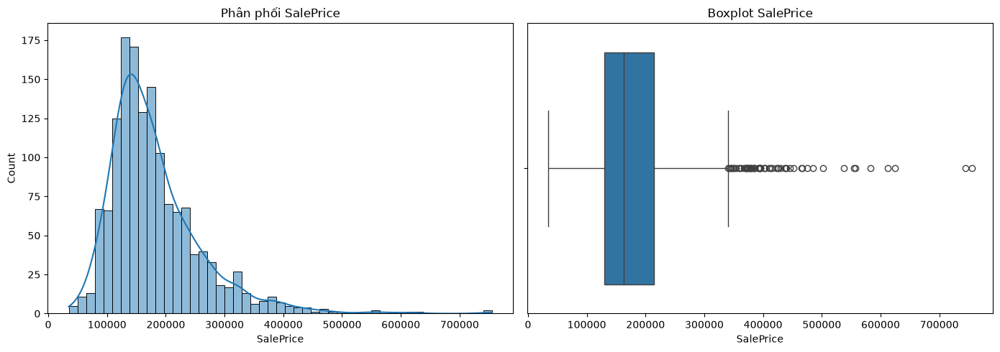
    


    Mean: 180921.19589041095
    Median: 163000.0
    Skewness: 1.8828757597682129
    

### Nhận xét về `SalePrice`

- Quan sát histogram để đánh giá hình dạng phân phối.
- So sánh mean và median để nhận biết độ lệch.
- Boxplot giúp quan sát các giá trị nằm xa phần lớn dữ liệu.
- Theo phần tổng quan trước đó, `SalePrice` có xu hướng **lệch phải**, do đó một số căn nhà có giá bán rất cao kéo dài đuôi phân phối về phía phải.

### 2.3. Phân tích các biến số quan trọng

Một số biến số có ý nghĩa trực tiếp đối với quy mô và đặc điểm căn nhà, ví dụ:
- `GrLivArea`: diện tích sinh hoạt trên mặt đất;
- `TotalBsmtSF`: tổng diện tích tầng hầm;
- `1stFlrSF`: diện tích tầng 1;
- `GarageArea`: diện tích gara;
- `YearBuilt`: năm xây dựng;
- `OverallQual`: chất lượng tổng thể.

Dùng histogram và boxplot để khảo sát phân phối của các biến này.


```python
important_numeric = [
    c for c in [
        'GrLivArea', 'TotalBsmtSF', '1stFlrSF',
        'GarageArea', 'YearBuilt', 'OverallQual'
    ] if c in df.columns
]

for col in important_numeric:
    fig, axes = plt.subplots(1, 2, figsize=(12, 4))

    sns.histplot(df[col].dropna(), kde=True, ax=axes[0])
    axes[0].set_title(f'Phân phối {col}')

    sns.boxplot(x=df[col], ax=axes[1])
    axes[1].set_title(f'Boxplot {col}')

    plt.tight_layout()
    plt.show()
```


    
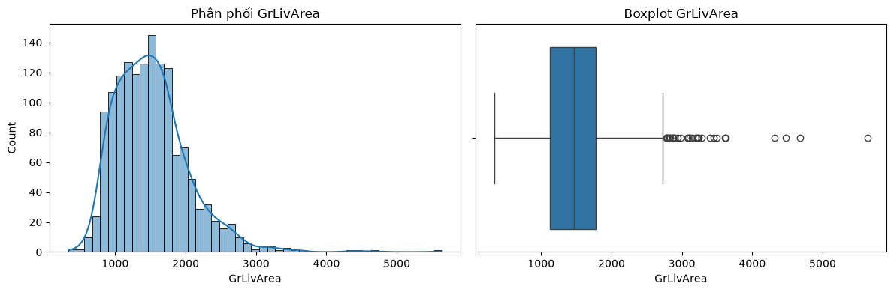
    


    
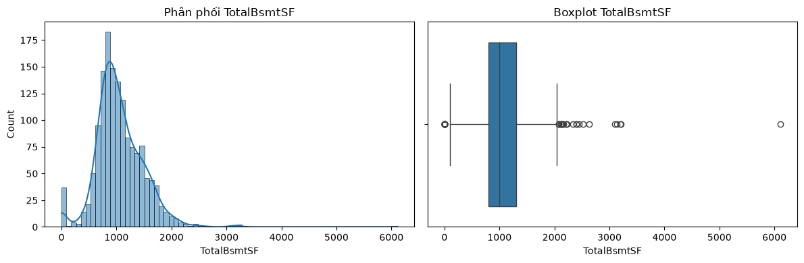
    


    
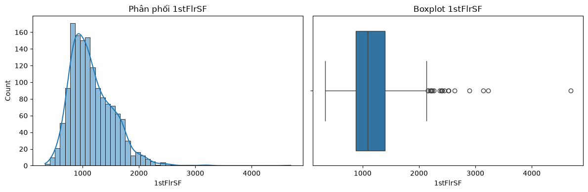
    


    
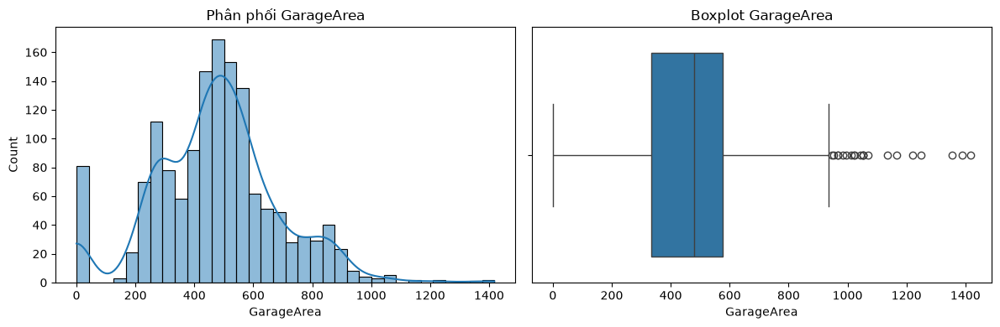
    


    
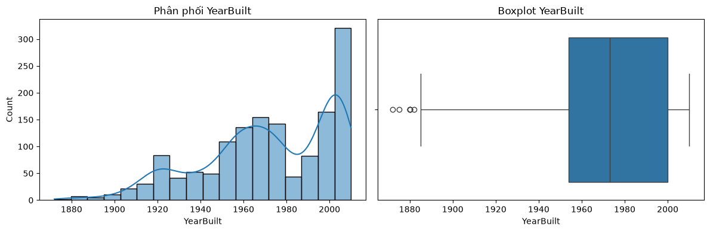
    


    
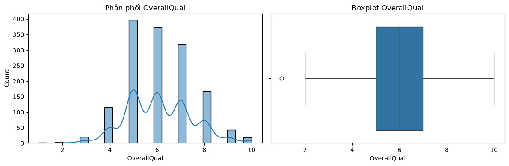
    


### 2.4. Phân tích đơn biến đối với biến phân loại

Với biến phân loại, thay vì tính trung bình, ta quan sát số lượng và tỷ lệ của từng nhóm. Điều này giúp phát hiện:
- nhóm chiếm đa số;
- nhóm rất hiếm;
- biến có quá nhiều mức;
- nhóm có tần suất bằng 0 hoặc gần 0.


```python
# Bảng tần suất của các biến phân loại
for col in categorical_cols:
    print(f'\n===== {col} =====')
    freq = df[col].value_counts(dropna=False)
    print(freq.head(15))
    print("Số mức:", df[col].nunique(dropna=False))
```

    
    ===== MSZoning =====
    MSZoning
    RL         1151
    RM          218
    FV           65
    RH           16
    C (all)      10
    Name: count, dtype: int64
    Số mức: 5
    
    ===== Street =====
    Street
    Pave    1454
    Grvl       6
    Name: count, dtype: int64
    Số mức: 2
    
    ===== Alley =====
    Alley
    NaN     1369
    Grvl      50
    Pave      41
    Name: count, dtype: int64
    Số mức: 3
    
    ===== LotShape =====
    LotShape
    Reg    925
    IR1    484
    IR2     41
    IR3     10
    Name: count, dtype: int64
    Số mức: 4
    
    ===== LandContour =====
    LandContour
    Lvl    1311
    Bnk      63
    HLS      50
    Low      36
    Name: count, dtype: int64
    Số mức: 4
    
    ===== Utilities =====
    Utilities
    AllPub    1459
    NoSeWa       1
    Name: count, dtype: int64
    Số mức: 2
    
    ===== LotConfig =====
    LotConfig
    Inside     1052
    Corner      263
    CulDSac      94
    FR2          47
    FR3           4
    Name: count, dtype: int64
    Số mức: 5
    
    ===== LandSlope =====
    LandSlope
    Gtl    1382
    Mod      65
    Sev      13
    Name: count, dtype: int64
    Số mức: 3
    
    ===== Neighborhood =====
    Neighborhood
    NAmes      225
    CollgCr    150
    OldTown    113
    Edwards    100
    Somerst     86
    Gilbert     79
    NridgHt     77
    Sawyer      74
    NWAmes      73
    SawyerW     59
    BrkSide     58
    Crawfor     51
    Mitchel     49
    NoRidge     41
    Timber      38
    Name: count, dtype: int64
    Số mức: 25
    
    ===== Condition1 =====
    Condition1
    Norm      1260
    Feedr       81
    Artery      48
    RRAn        26
    PosN        19
    RRAe        11
    PosA         8
    RRNn         5
    RRNe         2
    Name: count, dtype: int64
    Số mức: 9
    
    ===== Condition2 =====
    Condition2
    Norm      1445
    Feedr        6
    Artery       2
    RRNn         2
    PosN         2
    PosA         1
    RRAn         1
    RRAe         1
    Name: count, dtype: int64
    Số mức: 8
    
    ===== BldgType =====
    BldgType
    1Fam      1220
    TwnhsE     114
    Duplex      52
    Twnhs       43
    2fmCon      31
    Name: count, dtype: int64
    Số mức: 5
    
    ===== HouseStyle =====
    HouseStyle
    1Story    726
    2Story    445
    1.5Fin    154
    SLvl       65
    SFoyer     37
    1.5Unf     14
    2.5Unf     11
    2.5Fin      8
    Name: count, dtype: int64
    Số mức: 8
    
    ===== RoofStyle =====
    RoofStyle
    Gable      1141
    Hip         286
    Flat         13
    Gambrel      11
    Mansard       7
    Shed          2
    Name: count, dtype: int64
    Số mức: 6
    
    ===== RoofMatl =====
    RoofMatl
    CompShg    1434
    Tar&Grv      11
    WdShngl       6
    WdShake       5
    Metal         1
    Membran       1
    Roll          1
    ClyTile       1
    Name: count, dtype: int64
    Số mức: 8
    
    ===== Exterior1st =====
    Exterior1st
    VinylSd    515
    HdBoard    222
    MetalSd    220
    Wd Sdng    206
    Plywood    108
    CemntBd     61
    BrkFace     50
    WdShing     26
    Stucco      25
    AsbShng     20
    BrkComm      2
    Stone        2
    AsphShn      1
    ImStucc      1
    CBlock       1
    Name: count, dtype: int64
    Số mức: 15
    
    ===== Exterior2nd =====
    Exterior2nd
    VinylSd    504
    MetalSd    214
    HdBoard    207
    Wd Sdng    197
    Plywood    142
    CmentBd     60
    Wd Shng     38
    Stucco      26
    BrkFace     25
    AsbShng     20
    ImStucc     10
    Brk Cmn      7
    Stone        5
    AsphShn      3
    Other        1
    Name: count, dtype: int64
    Số mức: 16
    
    ===== MasVnrType =====
    MasVnrType
    NaN        872
    BrkFace    445
    Stone      128
    BrkCmn      15
    Name: count, dtype: int64
    Số mức: 4
    
    ===== ExterQual =====
    ExterQual
    TA    906
    Gd    488
    Ex     52
    Fa     14
    Name: count, dtype: int64
    Số mức: 4
    
    ===== ExterCond =====
    ExterCond
    TA    1282
    Gd     146
    Fa      28
    Ex       3
    Po       1
    Name: count, dtype: int64
    Số mức: 5
    
    ===== Foundation =====
    Foundation
    PConc     647
    CBlock    634
    BrkTil    146
    Slab       24
    Stone       6
    Wood        3
    Name: count, dtype: int64
    Số mức: 6
    
    ===== BsmtQual =====
    BsmtQual
    TA     649
    Gd     618
    Ex     121
    NaN     37
    Fa      35
    Name: count, dtype: int64
    Số mức: 5
    
    ===== BsmtCond =====
    BsmtCond
    TA     1311
    Gd       65
    Fa       45
    NaN      37
    Po        2
    Name: count, dtype: int64
    Số mức: 5
    
    ===== BsmtExposure =====
    BsmtExposure
    No     953
    Av     221
    Gd     134
    Mn     114
    NaN     38
    Name: count, dtype: int64
    Số mức: 5
    
    ===== BsmtFinType1 =====
    BsmtFinType1
    Unf    430
    GLQ    418
    ALQ    220
    BLQ    148
    Rec    133
    LwQ     74
    NaN     37
    Name: count, dtype: int64
    Số mức: 7
    
    ===== BsmtFinType2 =====
    BsmtFinType2
    Unf    1256
    Rec      54
    LwQ      46
    NaN      38
    BLQ      33
    ALQ      19
    GLQ      14
    Name: count, dtype: int64
    Số mức: 7
    
    ===== Heating =====
    Heating
    GasA     1428
    GasW       18
    Grav        7
    Wall        4
    OthW        2
    Floor       1
    Name: count, dtype: int64
    Số mức: 6
    
    ===== HeatingQC =====
    HeatingQC
    Ex    741
    TA    428
    Gd    241
    Fa     49
    Po      1
    Name: count, dtype: int64
    Số mức: 5
    
    ===== CentralAir =====
    CentralAir
    Y    1365
    N      95
    Name: count, dtype: int64
    Số mức: 2
    
    ===== Electrical =====
    Electrical
    SBrkr    1334
    FuseA      94
    FuseF      27
    FuseP       3
    Mix         1
    NaN         1
    Name: count, dtype: int64
    Số mức: 6
    
    ===== KitchenQual =====
    KitchenQual
    TA    735
    Gd    586
    Ex    100
    Fa     39
    Name: count, dtype: int64
    Số mức: 4
    
    ===== Functional =====
    Functional
    Typ     1360
    Min2      34
    Min1      31
    Mod       15
    Maj1      14
    Maj2       5
    Sev        1
    Name: count, dtype: int64
    Số mức: 7
    
    ===== FireplaceQu =====
    FireplaceQu
    NaN    690
    Gd     380
    TA     313
    Fa      33
    Ex      24
    Po      20
    Name: count, dtype: int64
    Số mức: 6
    
    ===== GarageType =====
    GarageType
    Attchd     870
    Detchd     387
    BuiltIn     88
    NaN         81
    Basment     19
    CarPort      9
    2Types       6
    Name: count, dtype: int64
    Số mức: 7
    
    ===== GarageFinish =====
    GarageFinish
    Unf    605
    RFn    422
    Fin    352
    NaN     81
    Name: count, dtype: int64
    Số mức: 4
    
    ===== GarageQual =====
    GarageQual
    TA     1311
    NaN      81
    Fa       48
    Gd       14
    Ex        3
    Po        3
    Name: count, dtype: int64
    Số mức: 6
    
    ===== GarageCond =====
    GarageCond
    TA     1326
    NaN      81
    Fa       35
    Gd        9
    Po        7
    Ex        2
    Name: count, dtype: int64
    Số mức: 6
    
    ===== PavedDrive =====
    PavedDrive
    Y    1340
    N      90
    P      30
    Name: count, dtype: int64
    Số mức: 3
    
    ===== PoolQC =====
    PoolQC
    NaN    1453
    Gd        3
    Ex        2
    Fa        2
    Name: count, dtype: int64
    Số mức: 4
    
    ===== Fence =====
    Fence
    NaN      1179
    MnPrv     157
    GdPrv      59
    GdWo       54
    MnWw       11
    Name: count, dtype: int64
    Số mức: 5
    
    ===== MiscFeature =====
    MiscFeature
    NaN     1406
    Shed      49
    Gar2       2
    Othr       2
    TenC       1
    Name: count, dtype: int64
    Số mức: 5
    
    ===== SaleType =====
    SaleType
    WD       1267
    New       122
    COD        43
    ConLD       9
    ConLI       5
    ConLw       5
    CWD         4
    Oth         3
    Con         2
    Name: count, dtype: int64
    Số mức: 9
    
    ===== SaleCondition =====
    SaleCondition
    Normal     1198
    Partial     125
    Abnorml     101
    Family       20
    Alloca       12
    AdjLand       4
    Name: count, dtype: int64
    Số mức: 6
    

### 2.5. Trực quan hóa một số biến phân loại quan trọng

Có thể dùng biểu đồ cột cho các biến có số lượng mức vừa phải. `Neighborhood`, `HouseStyle`, `BldgType`, `KitchenQual` và `ExterQual` là những biến có thể khảo sát trước.


```python
important_categorical = [
    c for c in [
        'Neighborhood', 'HouseStyle', 'BldgType',
        'KitchenQual', 'ExterQual', 'Foundation'
    ] if c in df.columns
]

for col in important_categorical:
    order = df[col].value_counts().index

    plt.figure(figsize=(10, 5))
    sns.countplot(data=df, x=col, order=order)
    plt.title(f'Tần suất các nhóm của {col}')
    plt.xlabel(col)
    plt.ylabel('Số lượng')
    plt.xticks(rotation=45)
    plt.tight_layout()
    plt.show()
```


    
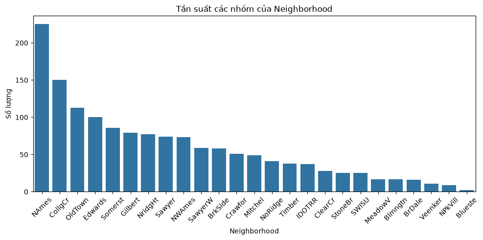
    


    
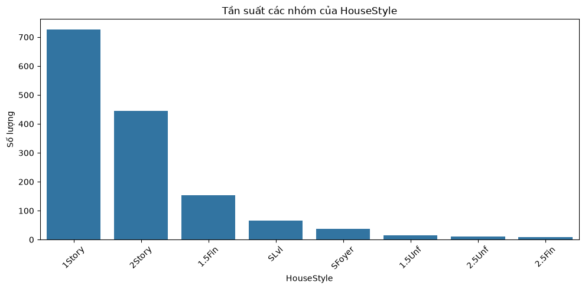
    


    
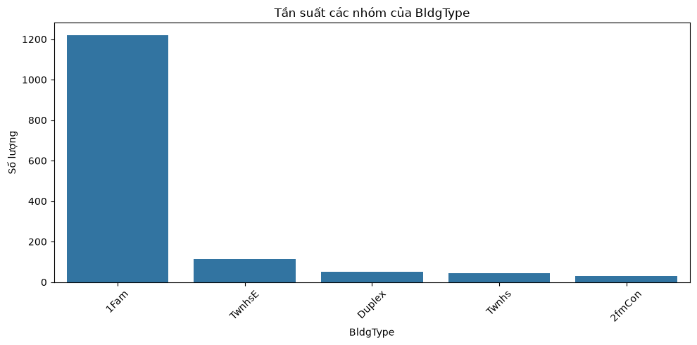
    


    
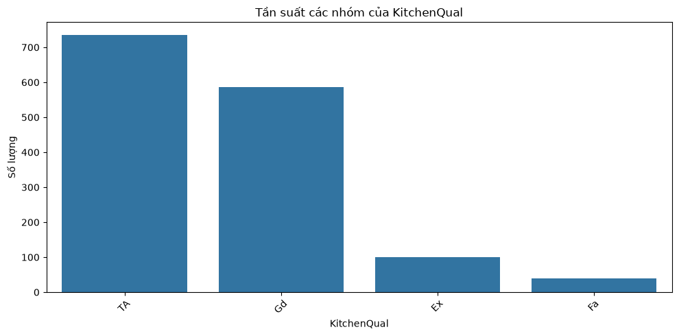
    


    
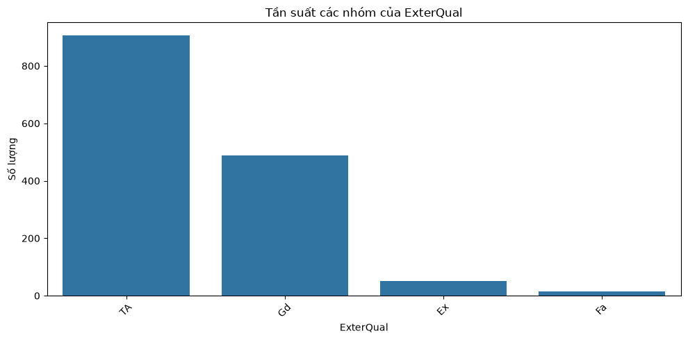
    


    
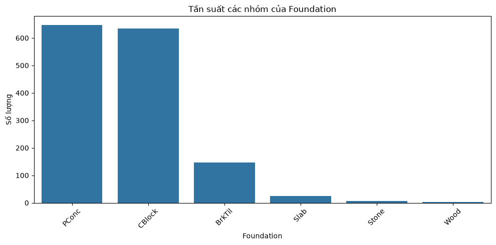
    


### 2.6. Tổng hợp kết quả phân tích đơn biến

Từ phân tích đơn biến, có thể ghi nhận:

- `SalePrice` có phân phối lệch phải, cần chú ý khi xây dựng mô hình.
- Một số biến diện tích có nhiều giá trị bằng 0; cần phân biệt đây là **không có đặc trưng đó** hay dữ liệu bị thiếu.
- Một số biến số có độ lệch lớn, cần kiểm tra thêm bằng boxplot và phân tích đa biến.
- Các biến phân loại có số lượng mức khác nhau; một số biến có thể có nhóm rất hiếm.
- `GrLivArea` cần được chú ý khi kiểm tra ngoại lệ. Phần kiểm tra ngoại lệ chi tiết sẽ được thực hiện ở bước tiếp theo, kết hợp với thông tin từ paper của De Cock.
- Phân tích đơn biến mới chỉ mô tả từng biến riêng lẻ; chưa thể kết luận biến nào thực sự ảnh hưởng mạnh đến `SalePrice`. Điều đó cần được kiểm tra ở **phân tích đa biến**.

# PHẦN 3: PHÂN TÍCH ĐA BIẾN 

**Dataset:** Ames Housing / Kaggle House Prices (train.csv)  
**Paper:** Dean De Cock (2011) – *Ames, Iowa: Alternative to the Boston Housing Data*  
**Mục tiêu:** Khám phá mối quan hệ giữa các biến với `SalePrice` và giữa các biến với nhau, phục vụ xây dựng mô hình hồi quy.


```python

target = 'SalePrice'

numeric_cols = df.select_dtypes(include=np.number).columns.tolist()
numeric_cols = [c for c in numeric_cols if c not in ['Id']]

categorical_cols = df.select_dtypes(exclude=np.number).columns.tolist()


area_cols = ['LotArea', 'MasVnrArea', 'BsmtFinSF1', 'BsmtFinSF2', 'BsmtUnfSF',
             'TotalBsmtSF', '1stFlrSF', '2ndFlrSF', 'LowQualFinSF', 'GrLivArea',
             'GarageArea', 'WoodDeckSF', 'OpenPorchSF', 'EnclosedPorch',
             '3SsnPorch', 'ScreenPorch', 'PoolArea']

print(f'Số biến số (trừ Id): {len(numeric_cols)}')
print(f'Số biến phân loại: {len(categorical_cols)}')
```

    Số biến số (trừ Id): 37
    Số biến phân loại: 43
    

---
## 3.1 Ma trận tương quan 

Mục tiêu: Xác định các biến số có tương quan mạnh với `SalePrice` và phát hiện multicollinearity giữa các feature.


```python

corr = df[numeric_cols].corr()


corr_target = corr[target].drop(target).sort_values(ascending=False)
print('=== Top 15 biến tương quan DƯƠNG với SalePrice ===')
display(corr_target.head(15).to_frame('corr_with_SalePrice'))
print('\n=== Top 10 biến tương quan ÂM với SalePrice ===')
display(corr_target.tail(10).to_frame('corr_with_SalePrice'))
```

    === Top 15 biến tương quan DƯƠNG với SalePrice ===
                  corr_with_SalePrice
    OverallQual                 0.791
    GrLivArea                   0.709
    GarageCars                  0.640
    GarageArea                  0.623
    TotalBsmtSF                 0.614
    1stFlrSF                    0.606
    FullBath                    0.561
    TotRmsAbvGrd                0.534
    YearBuilt                   0.523
    YearRemodAdd                0.507
    GarageYrBlt                 0.486
    MasVnrArea                  0.477
    Fireplaces                  0.467
    BsmtFinSF1                  0.386
    LotFrontage                 0.352
    
    === Top 10 biến tương quan ÂM với SalePrice ===
                   corr_with_SalePrice
    3SsnPorch                    0.045
    BsmtFinSF2                  -0.011
    BsmtHalfBath                -0.017
    MiscVal                     -0.021
    LowQualFinSF                -0.026
    YrSold                      -0.029
    OverallCond                 -0.078
    MSSubClass                  -0.084
    EnclosedPorch               -0.129
    KitchenAbvGr                -0.136
    


```python

plt.figure(figsize=(16, 14))
mask = np.triu(np.ones_like(corr, dtype=bool))
sns.heatmap(corr, mask=mask, cmap='RdBu_r', center=0,
            square=True, linewidths=0.3, cbar_kws={'shrink': 0.6},
            annot=False)
plt.title('Ma trận tương quan Pearson (biến số)', fontsize=14, fontweight='bold')
plt.tight_layout()
plt.show()
```


    
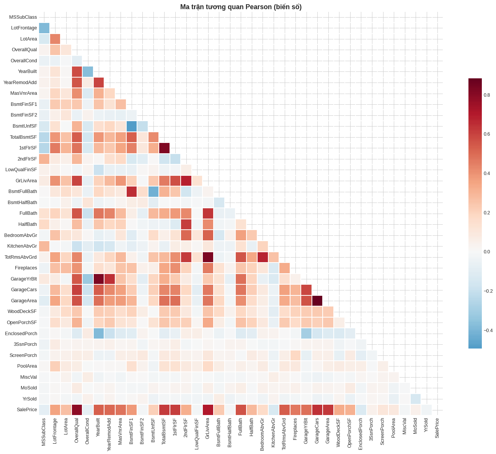
    


```python

strong_vars = corr_target[corr_target.abs() > 0.4].index.tolist() + [target]
corr_strong = df[strong_vars].corr()

plt.figure(figsize=(10, 8))
sns.heatmap(corr_strong, annot=True, fmt='.2f', cmap='RdBu_r', center=0,
            square=True, linewidths=0.5, cbar_kws={'shrink': 0.8})
plt.title('Heatmap: Biến có |corr| > 0.4 với SalePrice', fontsize=13, fontweight='bold')
plt.tight_layout()
plt.show()
```


    
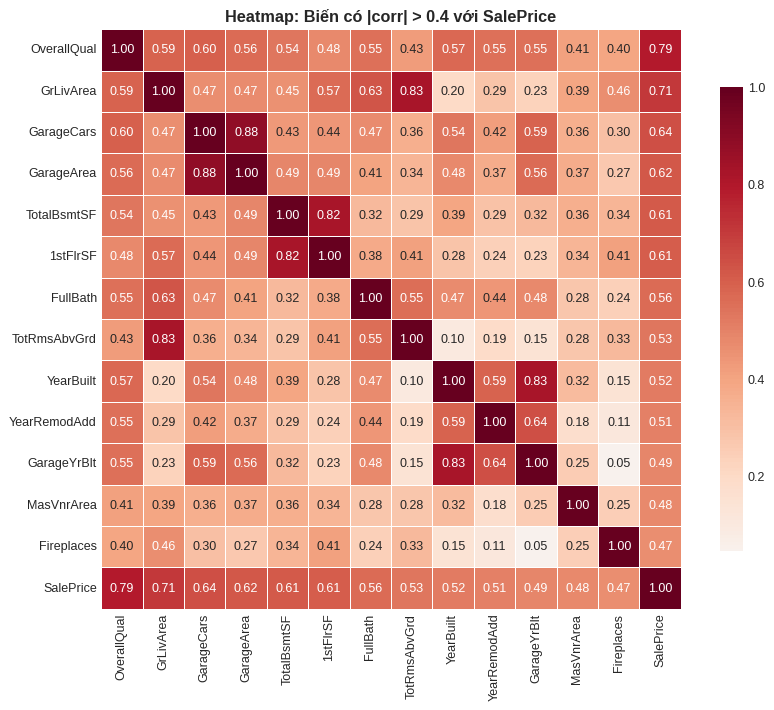
    


### Nhận xét tương quan

- **OverallQual** (chất lượng tổng thể) có tương quan cao nhất với `SalePrice` (~0.79).
- **GrLivArea** (diện tích sinh hoạt trên mặt đất) đứng thứ 2 (~0.71) – đúng như paper De Cock nhấn mạnh.
- **GarageCars / GarageArea**, **TotalBsmtSF**, **1stFlrSF**, **FullBath**, **TotRmsAbvGrd**, **YearBuilt** cũng là các predictor mạnh.
- Một số cặp feature có tương quan cao với nhau (multicollinearity tiềm ẩn):
  - `GarageCars` ↔ `GarageArea`
  - `TotalBsmtSF` ↔ `1stFlrSF`
  - `GrLivArea` ↔ `TotRmsAbvGrd`
  - `YearBuilt` ↔ `GarageYrBlt`

---
## 3.2 Quan hệ biến số 


```python

top_num = corr_target.head(8).index.tolist()

fig, axes = plt.subplots(2, 4, figsize=(18, 9))
axes = axes.flatten()

for i, col in enumerate(top_num):
    axes[i].scatter(df[col], df[target], alpha=0.4, s=15, edgecolors='none')
    mask = df[col].notna()
    if mask.sum() > 10:
        z = np.polyfit(df.loc[mask, col], df.loc[mask, target], 1)
        p = np.poly1d(z)
        x_line = np.linspace(df[col].min(), df[col].max(), 100)
        axes[i].plot(x_line, p(x_line), 'r-', lw=2, alpha=0.8)
    r = corr_target[col]
    axes[i].set_title(f'{col}\n(r = {r:.3f})', fontsize=11)
    axes[i].set_xlabel(col)
    axes[i].set_ylabel('SalePrice' if i % 4 == 0 else '')

plt.suptitle('Scatter: Top 8 biến số vs SalePrice (+ đường hồi quy tuyến tính)', fontsize=14, fontweight='bold')
plt.tight_layout()
plt.show()
```


    
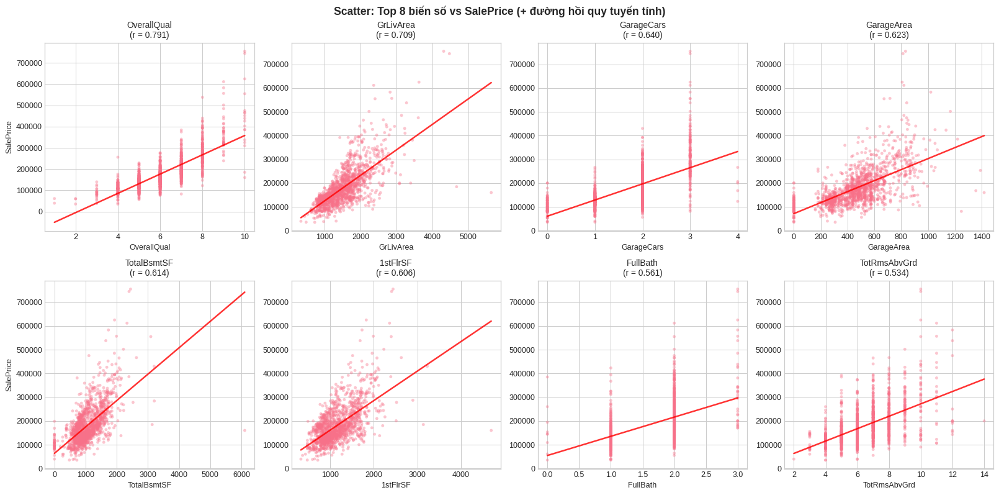
    


```python

pair_cols = ['SalePrice', 'GrLivArea', 'TotalBsmtSF', '1stFlrSF', 'GarageArea', 'LotArea']

sns.pairplot(df[pair_cols], diag_kind='kde', corner=True,
             plot_kws={'alpha': 0.3, 's': 12, 'edgecolor': 'none'})
plt.suptitle('Pairplot: Diện tích chính vs SalePrice', y=1.02, fontsize=13, fontweight='bold')
plt.show()
```


    
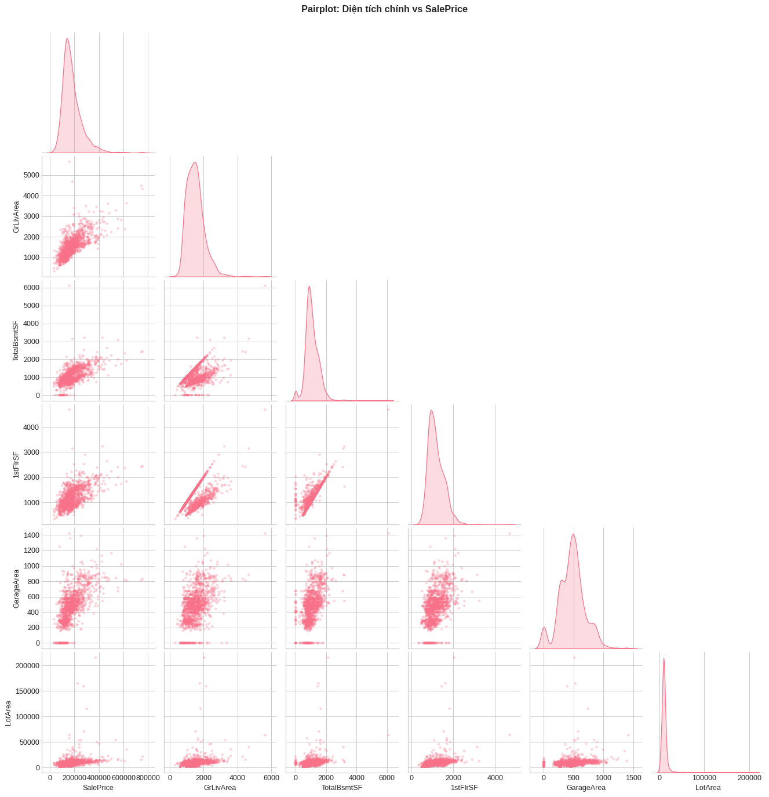
    


```python

df['TotalSF'] = df['TotalBsmtSF'].fillna(0) + df['GrLivArea']

fig, axes = plt.subplots(1, 2, figsize=(14, 5))

axes[0].scatter(df['TotalSF'], df['SalePrice'], alpha=0.4, s=15)
z = np.polyfit(df['TotalSF'], df['SalePrice'], 1)
p = np.poly1d(z)
x_line = np.linspace(df['TotalSF'].min(), df['TotalSF'].max(), 100)
axes[0].plot(x_line, p(x_line), 'r-', lw=2)
r_total = df[['TotalSF', 'SalePrice']].corr().iloc[0, 1]
axes[0].set_title(f'TotalSF (= TotalBsmtSF + GrLivArea) vs SalePrice\n(r = {r_total:.3f})')
axes[0].set_xlabel('TotalSF')
axes[0].set_ylabel('SalePrice')

outliers = df[df['GrLivArea'] > 4000]
axes[1].scatter(df['GrLivArea'], df['SalePrice'], alpha=0.4, s=15, label='Normal')
axes[1].scatter(outliers['GrLivArea'], outliers['SalePrice'], color='red', s=60, zorder=5, label='GrLivArea > 4000')
for _, row in outliers.iterrows():
    axes[1].annotate(f"Id={int(row['Id'])}", (row['GrLivArea'], row['SalePrice']),
                     textcoords='offset points', xytext=(5, 5), fontsize=8, color='red')
axes[1].axvline(4000, color='orange', linestyle='--', label='4000 sq ft')
axes[1].set_title('GrLivArea vs SalePrice\n(Outliers theo paper De Cock)')
axes[1].set_xlabel('GrLivArea')
axes[1].set_ylabel('SalePrice')
axes[1].legend()

plt.tight_layout()
plt.show()

print('Các quan sát GrLivArea > 4000:')
display(outliers[['Id', 'GrLivArea', 'TotalBsmtSF', 'OverallQual', 'SalePrice', 'SaleCondition', 'Neighborhood']])
```

    Các quan sát GrLivArea > 4000:
            Id  GrLivArea  TotalBsmtSF  OverallQual  SalePrice SaleCondition  \
    523    524       4676         3138           10     184750       Partial   
    691    692       4316         2444           10     755000        Normal   
    1182  1183       4476         2396           10     745000       Abnorml   
    1298  1299       5642         6110           10     160000       Partial   
    
         Neighborhood  
    523       Edwards  
    691       NoRidge  
    1182      NoRidge  
    1298      Edwards  
    


    
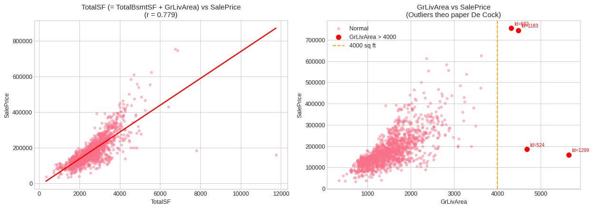
    


### Nhận xét scatter / pairplot

- Quan hệ **GrLivArea – SalePrice** và **TotalSF – SalePrice** gần tuyến tính nhưng có **heteroscedasticity** (phương sai tăng theo diện tích) – đúng nhận xét trong paper.
- 4 điểm `GrLivArea > 4000`: 2 điểm (Id 524, 1299) là **Partial sale** với giá thấp bất thường so với diện tích → paper khuyên loại bỏ.
- `OverallQual` phân tầng giá rõ ràng (thang 1–10).
- `GarageCars` có quan hệ bậc thang (0–4 cars); từ 3 trở lên ít quan sát hơn.

---
## 3.3 Quan hệ biến phân loại 


```python

ord_like = ['OverallQual', 'ExterQual', 'KitchenQual', 'BsmtQual', 'HeatingQC', 'GarageFinish']

fig, axes = plt.subplots(2, 3, figsize=(16, 10))
axes = axes.flatten()

for i, col in enumerate(ord_like):
    if col not in df.columns:
        continue
    order = df.groupby(col)[target].median().sort_values().index
    sns.boxplot(data=df, x=col, y=target, order=order, ax=axes[i], palette='Set2')
    axes[i].set_title(f'{col} vs SalePrice', fontsize=11)
    axes[i].tick_params(axis='x', rotation=30)
    axes[i].set_xlabel('')

plt.suptitle('Boxplot: Biến chất lượng / thứ tự vs SalePrice', fontsize=14, fontweight='bold')
plt.tight_layout()
plt.show()
```


    
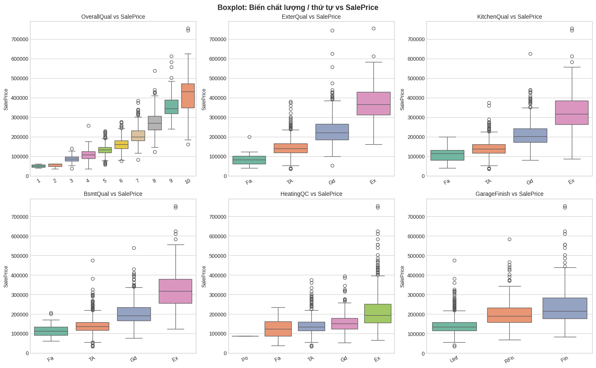
    


```python

plt.figure(figsize=(16, 6))
order = df.groupby('Neighborhood')[target].median().sort_values().index
sns.boxplot(data=df, x='Neighborhood', y=target, order=order, palette='viridis')
plt.xticks(rotation=60, ha='right')
plt.title('Neighborhood vs SalePrice (sắp theo median)', fontsize=13, fontweight='bold')
plt.tight_layout()
plt.show()

print('Top 5 Neighborhood giá cao nhất (median):')
display(df.groupby('Neighborhood')[target].agg(['count', 'median', 'mean']).sort_values('median', ascending=False).head())
print('\nBottom 5 Neighborhood giá thấp nhất (median):')
display(df.groupby('Neighborhood')[target].agg(['count', 'median', 'mean']).sort_values('median').head())
```

    Top 5 Neighborhood giá cao nhất (median):
                  count     median       mean
    Neighborhood                             
    NridgHt          77 315000.000 316270.623
    NoRidge          41 301500.000 335295.317
    StoneBr          25 278000.000 310499.000
    Timber           38 228475.000 242247.447
    Somerst          86 225500.000 225379.837
    
    Bottom 5 Neighborhood giá thấp nhất (median):
                  count     median       mean
    Neighborhood                             
    MeadowV          17  88000.000  98576.471
    IDOTRR           37 103000.000 100123.784
    BrDale           16 106000.000 104493.750
    OldTown         113 119000.000 128225.301
    Edwards         100 121750.000 128219.700
    


    
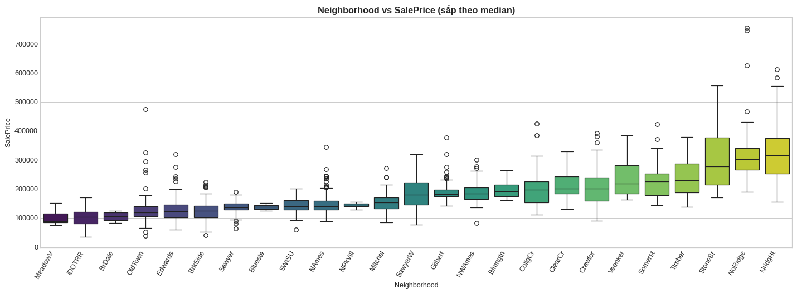
    


```python

fig, axes = plt.subplots(1, 2, figsize=(14, 5))

order_sc = df.groupby('SaleCondition')[target].median().sort_values().index
sns.boxplot(data=df, x='SaleCondition', y=target, order=order_sc, ax=axes[0], palette='pastel')
axes[0].set_title('SaleCondition vs SalePrice')
axes[0].tick_params(axis='x', rotation=30)

order_mz = df.groupby('MSZoning')[target].median().sort_values().index
sns.boxplot(data=df, x='MSZoning', y=target, order=order_mz, ax=axes[1], palette='pastel')
axes[1].set_title('MSZoning vs SalePrice')

plt.tight_layout()
plt.show()

print('SaleCondition value counts + median price:')
display(df.groupby('SaleCondition')[target].agg(['count', 'median', 'mean']).sort_values('median', ascending=False))
```

    SaleCondition value counts + median price:
                   count     median       mean
    SaleCondition                             
    Partial          125 244600.000 272291.752
    Normal          1198 160000.000 175202.220
    Alloca            12 148145.000 167377.417
    Family            20 140500.000 149600.000
    Abnorml          101 130000.000 146526.624
    AdjLand            4 104000.000 104125.000
    


    
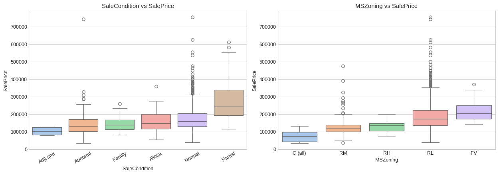
    


```python

fig, axes = plt.subplots(1, 3, figsize=(15, 4))

sns.boxplot(data=df, x='CentralAir', y=target, ax=axes[0], palette='Set2')
axes[0].set_title('CentralAir vs SalePrice')

sns.boxplot(data=df, x='Fireplaces', y=target, ax=axes[1], palette='Set2')
axes[1].set_title('Fireplaces vs SalePrice')

sns.boxplot(data=df, x='GarageCars', y=target, ax=axes[2], palette='Set2')
axes[2].set_title('GarageCars vs SalePrice')

plt.tight_layout()
plt.show()
```


    
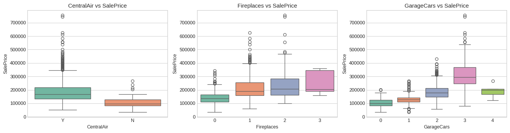
    


### Nhận xét biến phân loại

- **OverallQual / KitchenQual / ExterQual / BsmtQual**: thang chất lượng tăng → giá tăng rõ ràng (đơn điệu).
- **Neighborhood**: khác biệt lớn giữa các khu (NoRidge, NridgHt, StoneBr giá cao; MeadowV, IDOTRR, BrDale giá thấp). Paper khuyến nghị dùng dummy cho biến này.
- **SaleCondition = Partial**: giá trung bình cao hơn (nhà mới xây) nhưng cũng chứa outlier diện tích lớn giá thấp.
- **SaleCondition = Abnormal**: giá thấp hơn (short sale / foreclosure).
- **CentralAir = Y**, **Fireplaces ≥ 1**, **GarageCars = 2–3** gắn với giá cao hơn.

---
## 3.4 Tương tác & Insight từ paper De Cock

Paper ghi nhận: *~80% biến thiên SalePrice có thể giải thích chỉ bằng Neighborhood + TotalSF*.


```python
# Scatter TotalSF vs SalePrice, tô màu theo SaleCondition (Figure 7 trong paper)
plt.figure(figsize=(12, 6))
for cond, color in zip(['Normal', 'Partial', 'Abnormal', 'Family', 'Alloca', 'AdjLand'],
                       ['#4c72b0', '#dd8452', '#55a868', '#c44e52', '#8172b3', '#937860']):
    subset = df[df['SaleCondition'] == cond]
    if len(subset) > 0:
        plt.scatter(subset['TotalSF'], subset['SalePrice'], alpha=0.5, s=20, label=cond, c=color)

plt.xlabel('TotalSF (Basement + Above Grade)')
plt.ylabel('SalePrice')
plt.title('SalePrice vs TotalSF by SaleCondition (tái hiện ý Figure 7 paper)', fontsize=13, fontweight='bold')
plt.legend(title='SaleCondition')
plt.tight_layout()
plt.show()
```


    
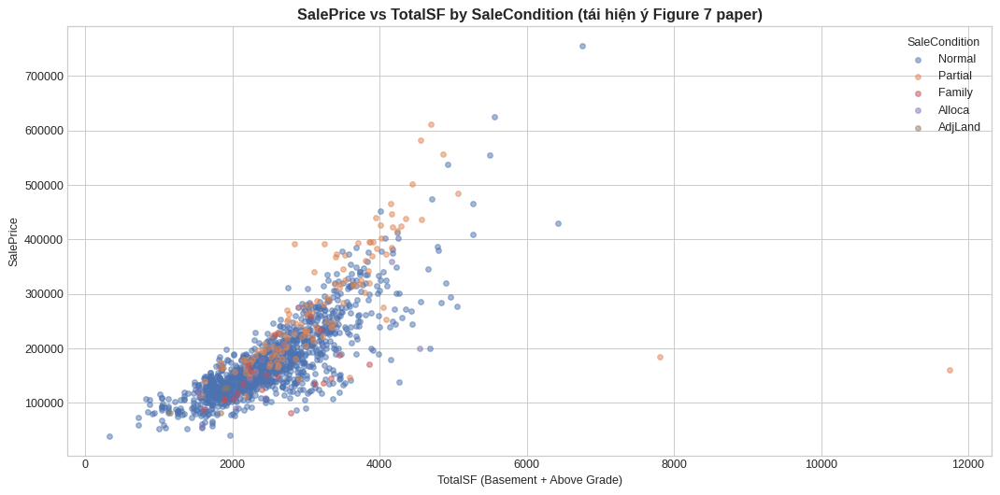
    


```python

import statsmodels.formula.api as smf

simple_df = df[['TotalSF', 'Neighborhood', 'SalePrice']].dropna().copy()
simple_df['log_price'] = np.log(simple_df['SalePrice'])


model = smf.ols('log_price ~ TotalSF + C(Neighborhood)', data=simple_df).fit()

print(f'R² (train) của mô hình log(SalePrice) ~ TotalSF + Neighborhood: {model.rsquared:.4f}')
print(f'R² adjusted: {model.rsquared_adj:.4f}')
print(f'Số quan sát: {int(model.nobs)}')
print(f'Số hệ số (gồm intercept + dummies): {len(model.params)}')
print()
print('→ Khớp với nhận xét paper: chỉ 2 biến này đã giải thích phần lớn biến thiên giá (~80%).')
print()
print(model.summary().tables[0])

```

    R² (train) của mô hình log(SalePrice) ~ TotalSF + Neighborhood: 0.7764
    R² adjusted: 0.7725
    Số quan sát: 1460
    Số hệ số (gồm intercept + dummies): 26
    
    → Khớp với nhận xét paper: chỉ 2 biến này đã giải thích phần lớn biến thiên giá (~80%).
    
                                OLS Regression Results                            
    ==============================================================================
    Dep. Variable:              log_price   R-squared:                       0.776
    Model:                            OLS   Adj. R-squared:                  0.773
    Method:                 Least Squares   F-statistic:                     199.2
    Date:                Fri, 02 Oct 2026   Prob (F-statistic):               0.00
    Time:                        15:47:50   Log-Likelihood:                 362.12
    No. Observations:                1460   AIC:                            -672.2
    Df Residuals:                    1434   BIC:                            -534.8
    Df Model:                          25                                         
    Covariance Type:            nonrobust                                         
    ==============================================================================
    


```python

df['Qual_x_Area'] = df['OverallQual'] * df['GrLivArea']

fig, axes = plt.subplots(1, 2, figsize=(14, 5))

scatter = axes[0].scatter(df['GrLivArea'], df['SalePrice'], c=df['OverallQual'],
                          cmap='RdYlGn', alpha=0.6, s=20)
plt.colorbar(scatter, ax=axes[0], label='OverallQual')
axes[0].set_xlabel('GrLivArea')
axes[0].set_ylabel('SalePrice')
axes[0].set_title('GrLivArea vs SalePrice (màu = OverallQual)')

axes[1].scatter(df['Qual_x_Area'], df['SalePrice'], alpha=0.4, s=15)
r_int = df[['Qual_x_Area', 'SalePrice']].corr().iloc[0, 1]
axes[1].set_xlabel('OverallQual × GrLivArea')
axes[1].set_ylabel('SalePrice')
axes[1].set_title(f'Tương tác OverallQual × GrLivArea\n(r = {r_int:.3f})')

plt.tight_layout()
plt.show()
```


    
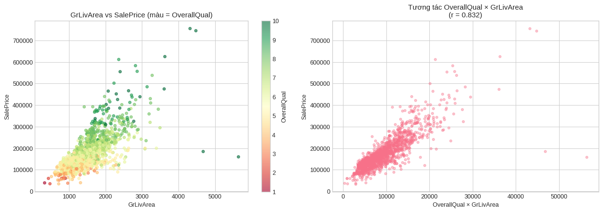
    


---
## 3.5 Multicollinearity 

Các cặp biến diện tích / garage thường tương quan cao → cần kiểm tra VIF trước khi đưa vào mô hình tuyến tính.


```python
from statsmodels.stats.outliers_influence import variance_inflation_factor
from statsmodels.tools.tools import add_constant

vif_candidates = ['OverallQual', 'GrLivArea', 'TotalBsmtSF', '1stFlrSF',
                  'GarageCars', 'GarageArea', 'FullBath', 'TotRmsAbvGrd',
                  'YearBuilt', 'YearRemodAdd']

vif_df = df[vif_candidates].dropna().copy()
X_vif = add_constant(vif_df)

vif_data = pd.DataFrame({
    'feature': X_vif.columns,
    'VIF': [variance_inflation_factor(X_vif.values, i) for i in range(X_vif.shape[1])]
})
vif_data = vif_data[vif_data['feature'] != 'const'].sort_values('VIF', ascending=False)
print('Variance Inflation Factor (VIF):')
display(vif_data)
print('\nGợi ý: VIF > 5–10 thường bị coi là multicollinearity đáng kể.')
print('→ Có thể giữ GarageCars thay vì GarageArea, hoặc TotalBsmtSF thay vì 1stFlrSF, v.v.')
```

    Variance Inflation Factor (VIF):
             feature   VIF
    5     GarageCars 5.251
    2      GrLivArea 5.019
    6     GarageArea 4.931
    4       1stFlrSF 3.685
    3    TotalBsmtSF 3.603
    8   TotRmsAbvGrd 3.357
    1    OverallQual 2.749
    9      YearBuilt 2.346
    7       FullBath 2.215
    10  YearRemodAdd 1.751
    
    Gợi ý: VIF > 5–10 thường bị coi là multicollinearity đáng kể.
    → Có thể giữ GarageCars thay vì GarageArea, hoặc TotalBsmtSF thay vì 1stFlrSF, v.v.
    


```python

plt.figure(figsize=(9, 7))
sns.heatmap(df[vif_candidates].corr(), annot=True, fmt='.2f', cmap='RdBu_r', center=0,
            square=True, linewidths=0.5)
plt.title('Correlation giữa các biến candidate (multicollinearity)', fontsize=12, fontweight='bold')
plt.tight_layout()
plt.show()
```


    
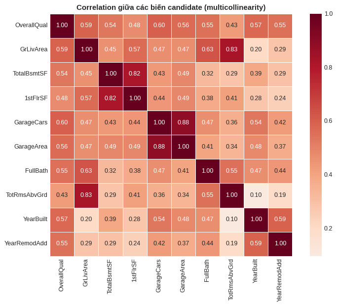
    


---
## 3.6 Tổng hợp nhận xét & gợi ý cho mô hình

### 3.6.1 Biến quan trọng nhất (từ phân tích đa biến)

| Nhóm | Biến | Ghi chú |
|------|------|--------|
| Chất lượng | `OverallQual`, `KitchenQual`, `ExterQual`, `BsmtQual` | Tương quan cao, đơn điệu |
| Diện tích | `GrLivArea`, `TotalBsmtSF`, `TotalSF` (tạo mới), `1stFlrSF`, `GarageArea` | Paper nhấn mạnh TotalSF |
| Vị trí | `Neighborhood` | Dummy encoding, khác biệt lớn |
| Thời gian | `YearBuilt`, `YearRemodAdd` | |
| Tiện ích | `GarageCars`, `FullBath`, `Fireplaces`, `CentralAir` | |
| Điều kiện bán | `SaleCondition` | Partial / Abnormal cần chú ý |

### 3.6.2 Vấn đề cần xử lý trước khi model

1. **Outliers**: Loại Id 524 & 1299 (`GrLivArea > 4000` + Partial + giá thấp) theo khuyến nghị paper.
2. **Skewness**: `SalePrice`, `LotArea`, `GrLivArea`… lệch phải → `log1p` hoặc Box-Cox.
3. **Multicollinearity**: `GarageCars`/`GarageArea`, `TotalBsmtSF`/`1stFlrSF` → chọn 1 hoặc dùng PCA / regularization.
4. **Missing**: Nhiều cột “thiếu” thực chất là *không có* (PoolQC, Alley, Fence…) → mã hóa thành category “None”.
5. **Tương tác**: `OverallQual × GrLivArea`, `Neighborhood × TotalSF` có thể cải thiện mô hình.

### 3.6.3 Liên hệ paper De Cock

- Dataset Kaggle train (1460) là một phần của bộ 2930 quan sát gốc.
- Paper: Neighborhood + TotalSF ≈ 80% R²; mô hình phức tạp hơn đạt ~92%.
- Khuyến nghị loại nhà > 4000 sq ft trước khi giao cho sinh viên.
- Biến ordinal / discrete có thể cho hệ số không đơn điệu nếu không collapse category.


```python

print('=== Tóm tắt nhanh ===')
print(f'Số quan sát: {len(df)}')
print(f'Số biến số phân tích: {len(numeric_cols)}')
print(f'Số biến phân loại: {len(categorical_cols)}')
print(f'Top 5 corr với SalePrice: {corr_target.head(5).index.tolist()}')
print(f'Số quan sát GrLivArea > 4000: {(df["GrLivArea"] > 4000).sum()}')
print(f'Corr(TotalSF, SalePrice): {df[["TotalSF", "SalePrice"]].corr().iloc[0,1]:.3f}')
```

    === Tóm tắt nhanh ===
    Số quan sát: 1460
    Số biến số phân tích: 37
    Số biến phân loại: 43
    Top 5 corr với SalePrice: ['OverallQual', 'GrLivArea', 'GarageCars', 'GarageArea', 'TotalBsmtSF']
    Số quan sát GrLivArea > 4000: 4
    Corr(TotalSF, SalePrice): 0.779
    

## 4.1. Giá trị thiếu (Missing values)

### 4.1.1. Thống kê giá trị thiếu


```python
miss = df.isna().sum()
miss = miss[miss > 0].sort_values(ascending=False)

miss_df = pd.DataFrame({
    'so_dong_thieu': miss,
    'ty_le_%': (miss / len(df) * 100).round(2),
})
display(miss_df)
print(f"{len(miss)} / {df.shape[1]} cột có giá trị thiếu")

plt.figure(figsize=(9, 6))
sns.barplot(x=miss_df['ty_le_%'], y=miss_df.index, color='#4C72B0')
plt.xlabel('Tỷ lệ thiếu (%)'); plt.ylabel('')
plt.title('Tỷ lệ giá trị thiếu theo cột (train)')
plt.tight_layout()
plt.show()
```


<div>
<style scoped>
    .dataframe tbody tr th:only-of-type {
        vertical-align: middle;
    }

    .dataframe tbody tr th {
        vertical-align: top;
    }

    .dataframe thead th {
        text-align: right;
    }
</style>
<table border="1" class="dataframe">
  <thead>
    <tr style="text-align: right;">
      <th></th>
      <th>so_dong_thieu</th>
      <th>ty_le_%</th>
    </tr>
  </thead>
  <tbody>
    <tr>
      <th>PoolQC</th>
      <td>1453</td>
      <td>99.52</td>
    </tr>
    <tr>
      <th>MiscFeature</th>
      <td>1406</td>
      <td>96.30</td>
    </tr>
    <tr>
      <th>Alley</th>
      <td>1369</td>
      <td>93.77</td>
    </tr>
    <tr>
      <th>Fence</th>
      <td>1179</td>
      <td>80.75</td>
    </tr>
    <tr>
      <th>MasVnrType</th>
      <td>872</td>
      <td>59.73</td>
    </tr>
    <tr>
      <th>FireplaceQu</th>
      <td>690</td>
      <td>47.26</td>
    </tr>
    <tr>
      <th>LotFrontage</th>
      <td>259</td>
      <td>17.74</td>
    </tr>
    <tr>
      <th>GarageType</th>
      <td>81</td>
      <td>5.55</td>
    </tr>
    <tr>
      <th>GarageYrBlt</th>
      <td>81</td>
      <td>5.55</td>
    </tr>
    <tr>
      <th>GarageFinish</th>
      <td>81</td>
      <td>5.55</td>
    </tr>
    <tr>
      <th>GarageQual</th>
      <td>81</td>
      <td>5.55</td>
    </tr>
    <tr>
      <th>GarageCond</th>
      <td>81</td>
      <td>5.55</td>
    </tr>
    <tr>
      <th>BsmtExposure</th>
      <td>38</td>
      <td>2.60</td>
    </tr>
    <tr>
      <th>BsmtFinType2</th>
      <td>38</td>
      <td>2.60</td>
    </tr>
    <tr>
      <th>BsmtQual</th>
      <td>37</td>
      <td>2.53</td>
    </tr>
    <tr>
      <th>BsmtCond</th>
      <td>37</td>
      <td>2.53</td>
    </tr>
    <tr>
      <th>BsmtFinType1</th>
      <td>37</td>
      <td>2.53</td>
    </tr>
    <tr>
      <th>MasVnrArea</th>
      <td>8</td>
      <td>0.55</td>
    </tr>
    <tr>
      <th>Electrical</th>
      <td>1</td>
      <td>0.07</td>
    </tr>
  </tbody>
</table>
</div>


    19 / 81 cột có giá trị thiếu
    


    
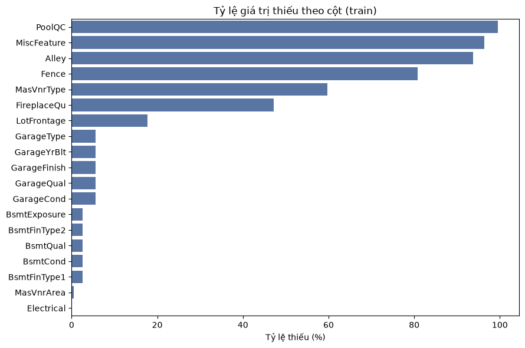
    


**Nhận xét ban đầu**

- 19 cột có giá trị thiếu. Bốn cột thiếu hơn 80% (`PoolQC`, `MiscFeature`, `Alley`, `Fence`), `MasVnrType` và `FireplaceQu` thiếu gần một nửa hoặc hơn.
- Các cột `Garage*` thiếu cùng một con số (81 dòng) và các cột `Bsmt*` thiếu gần cùng một con số (37-38 dòng). Thiếu **đồng loạt theo nhóm** như vậy là dấu hiệu của thiếu có nguyên nhân, không phải thiếu ngẫu nhiên.
- Trước khi kết luận "dữ liệu bị mất", cần kiểm tra xem `NaN` ở đây thật sự có nghĩa là gì.

### 4.1.2. Cẩn thận: pandas có thể hiểu sai chữ `NA` và `None`

Trong file gốc, chữ `NA` là một nhãn hợp lệ (vd. `Alley = NA` nghĩa là *không có ngõ phụ*) và `None` cũng là nhãn hợp lệ (vd. `MasVnrType = None` nghĩa là *không ốp đá/gạch*). Nhưng `pd.read_csv` mặc định đọc cả hai thành `NaN`. Đọc lại với `keep_default_na=False` để thấy file gốc thực sự chứa gì.


```python
raw = pd.read_csv(r'data/train.csv', keep_default_na=False)

chk = pd.DataFrame({
    'NaN (pandas)'       : df[miss.index].isna().sum(),
    "chữ 'NA' trong file": [(raw[c] == 'NA').sum()   for c in miss.index],
    "chữ 'None' trong file": [(raw[c] == 'None').sum() for c in miss.index],
})
chk
```


<div>
<style scoped>
    .dataframe tbody tr th:only-of-type {
        vertical-align: middle;
    }

    .dataframe tbody tr th {
        vertical-align: top;
    }

    .dataframe thead th {
        text-align: right;
    }
</style>
<table border="1" class="dataframe">
  <thead>
    <tr style="text-align: right;">
      <th></th>
      <th>NaN (pandas)</th>
      <th>chữ 'NA' trong file</th>
      <th>chữ 'None' trong file</th>
    </tr>
  </thead>
  <tbody>
    <tr>
      <th>PoolQC</th>
      <td>1453</td>
      <td>1453</td>
      <td>0</td>
    </tr>
    <tr>
      <th>MiscFeature</th>
      <td>1406</td>
      <td>1406</td>
      <td>0</td>
    </tr>
    <tr>
      <th>Alley</th>
      <td>1369</td>
      <td>1369</td>
      <td>0</td>
    </tr>
    <tr>
      <th>Fence</th>
      <td>1179</td>
      <td>1179</td>
      <td>0</td>
    </tr>
    <tr>
      <th>MasVnrType</th>
      <td>872</td>
      <td>8</td>
      <td>864</td>
    </tr>
    <tr>
      <th>FireplaceQu</th>
      <td>690</td>
      <td>690</td>
      <td>0</td>
    </tr>
    <tr>
      <th>LotFrontage</th>
      <td>259</td>
      <td>259</td>
      <td>0</td>
    </tr>
    <tr>
      <th>GarageType</th>
      <td>81</td>
      <td>81</td>
      <td>0</td>
    </tr>
    <tr>
      <th>GarageYrBlt</th>
      <td>81</td>
      <td>81</td>
      <td>0</td>
    </tr>
    <tr>
      <th>GarageFinish</th>
      <td>81</td>
      <td>81</td>
      <td>0</td>
    </tr>
    <tr>
      <th>GarageQual</th>
      <td>81</td>
      <td>81</td>
      <td>0</td>
    </tr>
    <tr>
      <th>GarageCond</th>
      <td>81</td>
      <td>81</td>
      <td>0</td>
    </tr>
    <tr>
      <th>BsmtExposure</th>
      <td>38</td>
      <td>38</td>
      <td>0</td>
    </tr>
    <tr>
      <th>BsmtFinType2</th>
      <td>38</td>
      <td>38</td>
      <td>0</td>
    </tr>
    <tr>
      <th>BsmtQual</th>
      <td>37</td>
      <td>37</td>
      <td>0</td>
    </tr>
    <tr>
      <th>BsmtCond</th>
      <td>37</td>
      <td>37</td>
      <td>0</td>
    </tr>
    <tr>
      <th>BsmtFinType1</th>
      <td>37</td>
      <td>37</td>
      <td>0</td>
    </tr>
    <tr>
      <th>MasVnrArea</th>
      <td>8</td>
      <td>8</td>
      <td>0</td>
    </tr>
    <tr>
      <th>Electrical</th>
      <td>1</td>
      <td>1</td>
      <td>0</td>
    </tr>
  </tbody>
</table>
</div>


**Nhận xét**

- `MasVnrType`: 872 `NaN` thực ra gồm **864 dòng là `None` (nhãn hợp lệ: không ốp)** và chỉ **8 dòng thiếu thật**. Nếu điền theo kiểu "cột này thiếu 60% nên bỏ" thì sẽ mất một biến có thông tin.
- Với `LotFrontage`, `GarageYrBlt`, `MasVnrArea`, `Electrical`, chữ `NA` là **thiếu thật** (cột số hoặc cột không có nhãn "không có").

### 4.1.3. Phân loại: thiếu có cấu trúc hay thiếu thật?

Theo mô tả dữ liệu, với các cột chất lượng/loại của gara, tầng hầm, lò sưởi, hồ bơi, hẻm, hàng rào, `NA` nghĩa là **căn nhà không có đặc trưng đó**. Có thể kiểm chứng giả thuyết này bằng các cột số đi kèm: nếu `PoolQC` là `NaN` thì `PoolArea` phải bằng 0, v.v.


```python
checks = {
    'PoolQC NaN      <-> PoolArea = 0'    : (df['PoolQC'].isna(),      df['PoolArea'] == 0),
    'MiscFeature NaN <-> MiscVal = 0'     : (df['MiscFeature'].isna(), df['MiscVal'] == 0),
    'FireplaceQu NaN <-> Fireplaces = 0'  : (df['FireplaceQu'].isna(), df['Fireplaces'] == 0),
    'GarageType NaN  <-> GarageArea = 0'  : (df['GarageType'].isna(),  df['GarageArea'] == 0),
    'BsmtQual NaN    <-> TotalBsmtSF = 0' : (df['BsmtQual'].isna(),    df['TotalBsmtSF'] == 0),
}
rows = []
for name, (is_nan, is_zero) in checks.items():
    rows.append({'quy tắc': name,
                 'số dòng NaN': int(is_nan.sum()),
                 'khớp với số = 0': int((is_nan & is_zero).sum()),
                 'khớp 100%': bool((is_nan & is_zero).sum() == is_nan.sum())})
display(pd.DataFrame(rows))

g = ['GarageType','GarageYrBlt','GarageFinish','GarageQual','GarageCond']
b = ['BsmtQual','BsmtCond','BsmtExposure','BsmtFinType1','BsmtFinType2']
print("Số dòng thiếu đồng thời cả 5 cột Garage:", df[g].isna().all(axis=1).sum())
print("Số dòng thiếu đồng thời cả 5 cột Bsmt  :", df[b].isna().all(axis=1).sum())

print("\nHai dòng CÓ tầng hầm nhưng thiếu 1 thuộc tính (thiếu thật):")
display(df.loc[df['BsmtQual'].notna() & df['BsmtExposure'].isna(),  ['Id','BsmtQual','BsmtExposure','TotalBsmtSF']])
display(df.loc[df['BsmtQual'].notna() & df['BsmtFinType2'].isna(), ['Id','BsmtFinType1','BsmtFinType2','BsmtFinSF2']])
```


<div>
<style scoped>
    .dataframe tbody tr th:only-of-type {
        vertical-align: middle;
    }

    .dataframe tbody tr th {
        vertical-align: top;
    }

    .dataframe thead th {
        text-align: right;
    }
</style>
<table border="1" class="dataframe">
  <thead>
    <tr style="text-align: right;">
      <th></th>
      <th>quy tắc</th>
      <th>số dòng NaN</th>
      <th>khớp với số = 0</th>
      <th>khớp 100%</th>
    </tr>
  </thead>
  <tbody>
    <tr>
      <th>0</th>
      <td>PoolQC NaN&nbsp;&nbsp;&nbsp;&nbsp;&nbsp;&nbsp;&lt;-&gt; PoolArea = 0</td>
      <td>1453</td>
      <td>1453</td>
      <td>True</td>
    </tr>
    <tr>
      <th>1</th>
      <td>MiscFeature NaN &lt;-&gt; MiscVal = 0</td>
      <td>1406</td>
      <td>1406</td>
      <td>True</td>
    </tr>
    <tr>
      <th>2</th>
      <td>FireplaceQu NaN &lt;-&gt; Fireplaces = 0</td>
      <td>690</td>
      <td>690</td>
      <td>True</td>
    </tr>
    <tr>
      <th>3</th>
      <td>GarageType NaN&nbsp;&nbsp;&lt;-&gt; GarageArea = 0</td>
      <td>81</td>
      <td>81</td>
      <td>True</td>
    </tr>
    <tr>
      <th>4</th>
      <td>BsmtQual NaN&nbsp;&nbsp;&nbsp;&nbsp;&lt;-&gt; TotalBsmtSF = 0</td>
      <td>37</td>
      <td>37</td>
      <td>True</td>
    </tr>
  </tbody>
</table>
</div>


    Số dòng thiếu đồng thời cả 5 cột Garage: 81
    Số dòng thiếu đồng thời cả 5 cột Bsmt  : 37
    
    Hai dòng CÓ tầng hầm nhưng thiếu 1 thuộc tính (thiếu thật):
    


<div>
<style scoped>
    .dataframe tbody tr th:only-of-type {
        vertical-align: middle;
    }

    .dataframe tbody tr th {
        vertical-align: top;
    }

    .dataframe thead th {
        text-align: right;
    }
</style>
<table border="1" class="dataframe">
  <thead>
    <tr style="text-align: right;">
      <th></th>
      <th>Id</th>
      <th>BsmtQual</th>
      <th>BsmtExposure</th>
      <th>TotalBsmtSF</th>
    </tr>
  </thead>
  <tbody>
    <tr>
      <th>948</th>
      <td>949</td>
      <td>Gd</td>
      <td>NaN</td>
      <td>936</td>
    </tr>
  </tbody>
</table>
</div>


<div>
<style scoped>
    .dataframe tbody tr th:only-of-type {
        vertical-align: middle;
    }

    .dataframe tbody tr th {
        vertical-align: top;
    }

    .dataframe thead th {
        text-align: right;
    }
</style>
<table border="1" class="dataframe">
  <thead>
    <tr style="text-align: right;">
      <th></th>
      <th>Id</th>
      <th>BsmtFinType1</th>
      <th>BsmtFinType2</th>
      <th>BsmtFinSF2</th>
    </tr>
  </thead>
  <tbody>
    <tr>
      <th>332</th>
      <td>333</td>
      <td>GLQ</td>
      <td>NaN</td>
      <td>479</td>
    </tr>
  </tbody>
</table>
</div>


 **Kết luận phân loại**

Phần lớn dữ liệu thiếu là **thiếu có cấu trúc**, tức là đối tượng **không có đặc trưng đó**, không phải dữ liệu bị mất. Chỉ khoảng **280 ô** là thiếu thật, trong đó **`LotFrontage` chiếm phần lớn**.

- **Thiếu có cấu trúc:** `PoolQC`, `MiscFeature`, `Alley`, `Fence`, `FireplaceQu`, các cột `Garage*`, `Bsmt*` và `MasVnrType = None`.
- **Thiếu thật:** chủ yếu là `LotFrontage` (259 dòng), ngoài ra có một số ít ở `MasVnrType`, `MasVnrArea`, `Electrical`, `BsmtExposure` và `BsmtFinType2`.

> **Kết luận:** Khi tiền xử lý dữ liệu không nên coi tất cả giá trị thiếu là mất dữ liệu; cần phân biệt **“không có đặc trưng”** với **“thực sự không được ghi nhận”**.
### 4.1.4. Cơ chế thiếu của `LotFrontage` (nhóm B lớn nhất)

Để chọn cách điền, cần biết `LotFrontage` thiếu **ngẫu nhiên hoàn toàn (MCAR)** hay thiếu **có liên quan đến các biến khác (MAR)**.


```python
known = df[df['LotFrontage'].notna()].copy()
rng = np.random.RandomState(42)
methods = ['Median toàn cục', 'Median theo Neighborhood',
           'Median theo Neighborhood + LotConfig', 'Hồi quy: √LotArea + Neighborhood']
mae = {m: [] for m in methods}

for _ in range(30):
    idx = rng.choice(known.index, size=int(0.2 * len(known)), replace=False)
    tr, va = known.drop(idx), known.loc[idx]
    g_med = tr['LotFrontage'].median()

    p1 = np.full(len(va), g_med)
    nb = tr.groupby('Neighborhood')['LotFrontage'].median()
    p2 = va['Neighborhood'].map(nb).fillna(g_med).values
    nc = tr.groupby(['Neighborhood', 'LotConfig'])['LotFrontage'].median()
    p3 = np.array([nc.get((a, c), np.nan) for a, c in zip(va['Neighborhood'], va['LotConfig'])])
    p3 = np.where(np.isnan(p3), p2, p3)

    Xtr = pd.get_dummies(tr['Neighborhood']).astype(float); Xtr['sqrtLot'] = np.sqrt(tr['LotArea'])
    Xva = (pd.get_dummies(va['Neighborhood']).reindex(columns=Xtr.columns[:-1], fill_value=0)
             .astype(float)); Xva['sqrtLot'] = np.sqrt(va['LotArea'])
    beta, *_ = np.linalg.lstsq(Xtr.values, tr['LotFrontage'].values, rcond=None)
    p4 = Xva[Xtr.columns].values @ beta

    for m, p in zip(methods, [p1, p2, p3, p4]):
        mae[m].append(np.abs(va['LotFrontage'].values - p).mean())

pd.Series({m: np.mean(v) for m, v in mae.items()}, name='MAE (feet)').round(2).to_frame()
```


<div>
<style scoped>
    .dataframe tbody tr th:only-of-type {
        vertical-align: middle;
    }

    .dataframe tbody tr th {
        vertical-align: top;
    }

    .dataframe thead th {
        text-align: right;
    }
</style>
<table border="1" class="dataframe">
  <thead>
    <tr style="text-align: right;">
      <th></th>
      <th>MAE (feet)</th>
    </tr>
  </thead>
  <tbody>
    <tr>
      <th>Median toàn cục</th>
      <td>16.85</td>
    </tr>
    <tr>
      <th>Median theo Neighborhood</th>
      <td>13.46</td>
    </tr>
    <tr>
      <th>Median theo Neighborhood + LotConfig</th>
      <td>12.88</td>
    </tr>
    <tr>
      <th>Hồi quy: √LotArea + Neighborhood</th>
      <td>12.02</td>
    </tr>
  </tbody>
</table>
</div>


**Nhận xét:** điền theo median của từng `Neighborhood` giảm sai số khoảng 20% so với median toàn cục, và là cách đơn giản, dễ giải thích. Hồi quy theo `√LotArea` + `Neighborhood` còn tốt hơn một chút nhưng phức tạp hơn; có thể dùng nếu muốn tối ưu thêm. Ở đây chọn **median theo `Neighborhood`** (học từ `train`).

**Thí nghiệm chọn cách điền:** che ngẫu nhiên 20% giá trị `LotFrontage` đã biết, điền lại bằng từng cách, đo sai số tuyệt đối trung bình (MAE), lặp 30 lần.


```python
known = df[df['LotFrontage'].notna()].copy()
rng = np.random.RandomState(42)
methods = ['Median toàn cục', 'Median theo Neighborhood',
           'Median theo Neighborhood + LotConfig', 'Hồi quy: √LotArea + Neighborhood']
mae = {m: [] for m in methods}

for _ in range(30):
    idx = rng.choice(known.index, size=int(0.2 * len(known)), replace=False)
    tr, va = known.drop(idx), known.loc[idx]
    g_med = tr['LotFrontage'].median()

    p1 = np.full(len(va), g_med)
    nb = tr.groupby('Neighborhood')['LotFrontage'].median()
    p2 = va['Neighborhood'].map(nb).fillna(g_med).values
    nc = tr.groupby(['Neighborhood', 'LotConfig'])['LotFrontage'].median()
    p3 = np.array([nc.get((a, c), np.nan) for a, c in zip(va['Neighborhood'], va['LotConfig'])])
    p3 = np.where(np.isnan(p3), p2, p3)

    Xtr = pd.get_dummies(tr['Neighborhood']).astype(float); Xtr['sqrtLot'] = np.sqrt(tr['LotArea'])
    Xva = (pd.get_dummies(va['Neighborhood']).reindex(columns=Xtr.columns[:-1], fill_value=0)
             .astype(float)); Xva['sqrtLot'] = np.sqrt(va['LotArea'])
    beta, *_ = np.linalg.lstsq(Xtr.values, tr['LotFrontage'].values, rcond=None)
    p4 = Xva[Xtr.columns].values @ beta

    for m, p in zip(methods, [p1, p2, p3, p4]):
        mae[m].append(np.abs(va['LotFrontage'].values - p).mean())

pd.Series({m: np.mean(v) for m, v in mae.items()}, name='MAE (feet)').round(2).to_frame()
```


<div>
<style scoped>
    .dataframe tbody tr th:only-of-type {
        vertical-align: middle;
    }

    .dataframe tbody tr th {
        vertical-align: top;
    }

    .dataframe thead th {
        text-align: right;
    }
</style>
<table border="1" class="dataframe">
  <thead>
    <tr style="text-align: right;">
      <th></th>
      <th>MAE (feet)</th>
    </tr>
  </thead>
  <tbody>
    <tr>
      <th>Median toàn cục</th>
      <td>16.85</td>
    </tr>
    <tr>
      <th>Median theo Neighborhood</th>
      <td>13.46</td>
    </tr>
    <tr>
      <th>Median theo Neighborhood + LotConfig</th>
      <td>12.88</td>
    </tr>
    <tr>
      <th>Hồi quy: √LotArea + Neighborhood</th>
      <td>12.02</td>
    </tr>
  </tbody>
</table>
</div>


**Nhận xét:** điền theo median của từng `Neighborhood` giảm sai số khoảng 20% so với median toàn cục, và là cách đơn giản, dễ giải thích. Hồi quy theo `√LotArea` + `Neighborhood` còn tốt hơn một chút nhưng phức tạp hơn; có thể dùng nếu muốn tối ưu thêm. Ở đây chọn **median theo `Neighborhood`** (học từ `train`).


## 4.1.5. Hướng giải quyết cho từng nhóm

- `PoolQC`, `MiscFeature`, `Alley`, `Fence`, `FireplaceQu`: điền `'None'` vì biểu thị **không có đặc trưng**.
- `Garage*`, `Bsmt*`: không có gara/hầm → `'None'`; có nhưng thiếu thuộc tính → **mode**.
- `MasVnrType`: điền `'None'`.
- `MasVnrArea`: điền `0`.
- `GarageYrBlt`: điền bằng `YearBuilt`.
- `LotFrontage`: điền **median theo `Neighborhood`**.
- `Electrical`: điền **mode (`SBrkr`)**.
- Các cột chỉ thiếu ở `test`: cột chữ → **mode**, cột số → **median của `train`**.

### Nguyên tắc chung

- **Xoá dòng:** Không sử dụng.
- **Xoá cột:** Không xoá chỉ vì tỷ lệ thiếu cao.
- **Điền giá trị:** Là hướng xử lý chính, nhưng phải phù hợp với ý nghĩa của từng nhóm dữ liệu.

> **Kết luận:** Cần phân biệt **"không có đặc trưng"** và **"thực sự thiếu dữ liệu"**, sau đó lựa chọn phương pháp xử lý phù hợp.
### 4.1.6. Cài đặt: học tham số từ `train`, áp dụng cho cả `train` và `test`


```python
GARAGE_CAT = ['GarageType', 'GarageFinish', 'GarageQual', 'GarageCond']
BSMT_CAT   = ['BsmtQual', 'BsmtCond', 'BsmtExposure', 'BsmtFinType1', 'BsmtFinType2']
NONE_CAT   = ['PoolQC', 'MiscFeature', 'Alley', 'Fence', 'FireplaceQu', 'MasVnrType']

def fit_missing_params(train):
    """Học các tham số điền từ TRAIN."""
    has_b = train[BSMT_CAT].notna().any(axis=1)
    has_g = train[GARAGE_CAT].notna().any(axis=1)
    return {
        'lotfront_by_nb': train.groupby('Neighborhood')['LotFrontage'].median(),
        'lotfront_all'  : train['LotFrontage'].median(),
        'bsmt_mode'     : {c: train.loc[has_b, c].mode()[0] for c in BSMT_CAT},
        'garage_mode'   : {c: train.loc[has_g, c].mode()[0] for c in GARAGE_CAT},
        'mode'          : {c: train[c].mode()[0] for c in train.select_dtypes(exclude='number').columns},
        'median'        : train.select_dtypes('number').median(),
    }

def clean_missing(data, p):
    d = data.copy()

    # (1) Thiếu có cấu trúc: không có đặc trưng -> 'None'
    for c in NONE_CAT:
        d[c] = d[c].fillna('None')

    # (2) Hầm / gara: có thì điền mode, không có thì 'None'
    has_bsmt   = d[BSMT_CAT].notna().any(axis=1)
    has_garage = d[GARAGE_CAT].notna().any(axis=1)
    for c in BSMT_CAT:
        d[c] = d[c].fillna(pd.Series(np.where(has_bsmt,   p['bsmt_mode'][c],   'None'), index=d.index))
    for c in GARAGE_CAT:
        d[c] = d[c].fillna(pd.Series(np.where(has_garage, p['garage_mode'][c], 'None'), index=d.index))

    # (3) Biến số của hầm / gara / ốp mặt: không có -> 0
    zero_cols = ['MasVnrArea', 'BsmtFinSF1', 'BsmtFinSF2', 'BsmtUnfSF', 'TotalBsmtSF',
                 'BsmtFullBath', 'BsmtHalfBath', 'GarageCars', 'GarageArea']
    d[zero_cols] = d[zero_cols].fillna(0)

    # (4) GarageYrBlt là NĂM: không điền 0, dùng năm xây nhà
    d['GarageYrBlt'] = d['GarageYrBlt'].fillna(d['YearBuilt'])

    # (5) LotFrontage: median theo Neighborhood (học từ train)
    d['LotFrontage'] = (d['LotFrontage']
                        .fillna(d['Neighborhood'].map(p['lotfront_by_nb']))
                        .fillna(p['lotfront_all']))

    # (6) Phần còn lại (Electrical, vài cột chỉ thiếu ở test): mode / median của train
    for c in d.columns[d.isna().any()]:
        d[c] = d[c].fillna(p['mode'][c] if c in p['mode'] else p['median'][c])
    return d

params      = fit_missing_params(df)          # chỉ học từ train
train_clean = clean_missing(df,   params)
test_clean  = clean_missing(test, params)

print("Missing còn lại | train:", int(train_clean.isna().sum().sum()), "| test:", int(test_clean.isna().sum().sum()))
print("Số nhà không gara (GarageType='None'):", int((train_clean['GarageType'] == 'None').sum()), "(kỳ vọng 81)")
print("Số nhà không hầm  (BsmtQual='None')  :", int((train_clean['BsmtQual'] == 'None').sum()),  "(kỳ vọng 37)")
print("Shape train/test:", train_clean.shape, test_clean.shape)
```

    Missing còn lại | train: 0 | test: 0
    Số nhà không gara (GarageType='None'): 81 (kỳ vọng 81)
    Số nhà không hầm  (BsmtQual='None')  : 37 (kỳ vọng 37)
    Shape train/test: (1460, 81) (1459, 80)
    


```python
# Kiểm tra: việc điền LotFrontage có làm thay đổi phân phối nhiều không?
cmp = pd.DataFrame({'trước (chỉ giá trị có sẵn)': df['LotFrontage'].describe(),
                    'sau khi điền'               : train_clean['LotFrontage'].describe()}).round(1)
display(cmp)

fig, ax = plt.subplots(figsize=(8, 4))
sns.kdeplot(df['LotFrontage'].dropna(), label='trước', ax=ax)
sns.kdeplot(train_clean['LotFrontage'], label='sau khi điền', ax=ax)
ax.set_xlim(0, 200); ax.set_title('Phân phối LotFrontage trước và sau khi điền'); ax.legend()
plt.tight_layout(); plt.show()
```


<div>
<style scoped>
    .dataframe tbody tr th:only-of-type {
        vertical-align: middle;
    }

    .dataframe tbody tr th {
        vertical-align: top;
    }

    .dataframe thead th {
        text-align: right;
    }
</style>
<table border="1" class="dataframe">
  <thead>
    <tr style="text-align: right;">
      <th></th>
      <th>trước (chỉ giá trị có sẵn)</th>
      <th>sau khi điền</th>
    </tr>
  </thead>
  <tbody>
    <tr>
      <th>count</th>
      <td>1201.0</td>
      <td>1460.0</td>
    </tr>
    <tr>
      <th>mean</th>
      <td>70.0</td>
      <td>70.2</td>
    </tr>
    <tr>
      <th>std</th>
      <td>24.3</td>
      <td>22.4</td>
    </tr>
    <tr>
      <th>min</th>
      <td>21.0</td>
      <td>21.0</td>
    </tr>
    <tr>
      <th>25%</th>
      <td>59.0</td>
      <td>60.0</td>
    </tr>
    <tr>
      <th>50%</th>
      <td>69.0</td>
      <td>70.0</td>
    </tr>
    <tr>
      <th>75%</th>
      <td>80.0</td>
      <td>80.0</td>
    </tr>
    <tr>
      <th>max</th>
      <td>313.0</td>
      <td>313.0</td>
    </tr>
  </tbody>
</table>
</div>


    
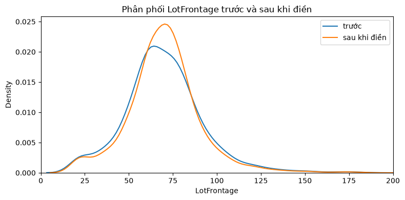
    


**Nhận xét**

- Phương pháp IQR gắn cờ rất nhiều điểm (vd. `LotArea`, `SalePrice`, `LotFrontage` có khoảng 4-7% số dòng), vì các biến này **lệch phải mạnh**: đuôi dài tự nhiên bị coi là "ngoại lệ". Đây là lý do **không nên xoá mọi điểm bị IQR gắn cờ**.
- Các biến có vài điểm cực lớn tách xa hẳn phần còn lại: `LotArea` (tới 215,245), `TotalBsmtSF` (6,110), `GrLivArea` (5,642), `LotFrontage` (313), `BsmtFinSF1` (5,644). Cần xem các điểm này có phải **cùng một vài căn nhà** hay không.

## 4.2. Ngoại lệ (Outliers)

Ngoại lệ là các đối tượng có giá trị khác biệt đáng kể so với phần lớn dữ liệu. Có hai nguồn gốc rất khác nhau:
- **Ngoại lệ thật**: một căn nhà đặc biệt (biệt thự rất lớn, giá rất cao). Đây là thông tin, không nên xoá bừa.
- **Nhiễu/lỗi**: nhập sai, giao dịch bất thường (không phản ánh quy luật chung). Nên sửa hoặc loại.

Vì vậy, thống kê chỉ giúp **phát hiện ứng viên**; quyết định xử lý phải dựa vào **ý nghĩa nghiệp vụ**.

### 4.2.1. Phát hiện bằng thống kê: IQR và z-score (đơn biến)

- **IQR**: giá trị nằm ngoài `[Q1 - 1.5·IQR, Q3 + 1.5·IQR]`.
- **z-score**: `|z| > 3`.
- Với các biến diện tích có nhiều số 0 ("không có"), tính trên **các giá trị > 0** (nếu để cả số 0 thì ngưỡng IQR bị méo).


```python
cont_cols = ['LotFrontage', 'LotArea', 'MasVnrArea', 'BsmtFinSF1', 'BsmtUnfSF', 'TotalBsmtSF',
             '1stFlrSF', '2ndFlrSF', 'GrLivArea', 'GarageArea', 'WoodDeckSF',
             'OpenPorchSF', 'EnclosedPorch', 'ScreenPorch', 'SalePrice']

def outlier_table(data, cols):
    rows = []
    for c in cols:
        s = data[c].dropna()
        s = s[s > 0]
        q1, q3 = s.quantile([.25, .75]); iqr = q3 - q1
        lo, hi = q1 - 1.5 * iqr, q3 + 1.5 * iqr
        n_iqr = int(((s < lo) | (s > hi)).sum())
        n_z   = int((np.abs(stats.zscore(s)) > 3).sum())
        rows.append({'cột': c, 'n (>0)': len(s), 'IQR': n_iqr, '% IQR': round(n_iqr / len(s) * 100, 1),
                     '|z|>3': n_z, 'ngưỡng trên': round(hi, 1), 'max': s.max(), 'skew': round(s.skew(), 2)})
    return pd.DataFrame(rows).set_index('cột')

out_tab = outlier_table(df, cont_cols)
out_tab
```


<div>
<style scoped>
    .dataframe tbody tr th:only-of-type {
        vertical-align: middle;
    }

    .dataframe tbody tr th {
        vertical-align: top;
    }

    .dataframe thead th {
        text-align: right;
    }
</style>
<table border="1" class="dataframe">
  <thead>
    <tr style="text-align: right;">
      <th></th>
      <th>n (&gt;0)</th>
      <th>IQR</th>
      <th>% IQR</th>
      <th>|z|&gt;3</th>
      <th>ngưỡng trên</th>
      <th>max</th>
      <th>skew</th>
    </tr>
    <tr>
      <th>cột</th>
      <th></th>
      <th></th>
      <th></th>
      <th></th>
      <th></th>
      <th></th>
      <th></th>
    </tr>
  </thead>
  <tbody>
    <tr>
      <th>LotFrontage</th>
      <td>1201</td>
      <td>88</td>
      <td>7.3</td>
      <td>12</td>
      <td>111.5</td>
      <td>313.0</td>
      <td>2.16</td>
    </tr>
    <tr>
      <th>LotArea</th>
      <td>1460</td>
      <td>69</td>
      <td>4.7</td>
      <td>13</td>
      <td>17673.5</td>
      <td>215245.0</td>
      <td>12.21</td>
    </tr>
    <tr>
      <th>MasVnrArea</th>
      <td>591</td>
      <td>28</td>
      <td>4.7</td>
      <td>12</td>
      <td>656.8</td>
      <td>1600.0</td>
      <td>2.09</td>
    </tr>
    <tr>
      <th>BsmtFinSF1</th>
      <td>993</td>
      <td>13</td>
      <td>1.3</td>
      <td>5</td>
      <td>1611.0</td>
      <td>5644.0</td>
      <td>2.30</td>
    </tr>
    <tr>
      <th>BsmtUnfSF</th>
      <td>1342</td>
      <td>30</td>
      <td>2.2</td>
      <td>11</td>
      <td>1676.1</td>
      <td>2336.0</td>
      <td>0.97</td>
    </tr>
    <tr>
      <th>TotalBsmtSF</th>
      <td>1423</td>
      <td>24</td>
      <td>1.7</td>
      <td>11</td>
      <td>2058.0</td>
      <td>6110.0</td>
      <td>2.17</td>
    </tr>
    <tr>
      <th>1stFlrSF</th>
      <td>1460</td>
      <td>20</td>
      <td>1.4</td>
      <td>12</td>
      <td>2155.1</td>
      <td>4692.0</td>
      <td>1.38</td>
    </tr>
    <tr>
      <th>2ndFlrSF</th>
      <td>631</td>
      <td>19</td>
      <td>3.0</td>
      <td>4</td>
      <td>1378.8</td>
      <td>2065.0</td>
      <td>0.70</td>
    </tr>
    <tr>
      <th>GrLivArea</th>
      <td>1460</td>
      <td>31</td>
      <td>2.1</td>
      <td>16</td>
      <td>2747.6</td>
      <td>5642.0</td>
      <td>1.37</td>
    </tr>
    <tr>
      <th>GarageArea</th>
      <td>1379</td>
      <td>46</td>
      <td>3.3</td>
      <td>8</td>
      <td>880.0</td>
      <td>1418.0</td>
      <td>0.81</td>
    </tr>
    <tr>
      <th>WoodDeckSF</th>
      <td>699</td>
      <td>32</td>
      <td>4.6</td>
      <td>11</td>
      <td>420.0</td>
      <td>857.0</td>
      <td>1.62</td>
    </tr>
    <tr>
      <th>OpenPorchSF</th>
      <td>804</td>
      <td>43</td>
      <td>5.3</td>
      <td>12</td>
      <td>221.5</td>
      <td>547.0</td>
      <td>2.25</td>
    </tr>
    <tr>
      <th>EnclosedPorch</th>
      <td>208</td>
      <td>2</td>
      <td>1.0</td>
      <td>2</td>
      <td>356.1</td>
      <td>552.0</td>
      <td>0.86</td>
    </tr>
    <tr>
      <th>ScreenPorch</th>
      <td>116</td>
      <td>6</td>
      <td>5.2</td>
      <td>2</td>
      <td>344.4</td>
      <td>480.0</td>
      <td>1.19</td>
    </tr>
    <tr>
      <th>SalePrice</th>
      <td>1460</td>
      <td>61</td>
      <td>4.2</td>
      <td>22</td>
      <td>340037.5</td>
      <td>755000.0</td>
      <td>1.88</td>
    </tr>
  </tbody>
</table>
</div>


```python
plot_cols = ['LotFrontage', 'LotArea', 'GrLivArea', 'TotalBsmtSF',
             '1stFlrSF', 'GarageArea', 'OpenPorchSF', 'SalePrice']
fig, axes = plt.subplots(2, 4, figsize=(18, 7))
for ax, c in zip(axes.ravel(), plot_cols):
    sns.boxplot(y=df[c], ax=ax, color='#8FB8DE', fliersize=3)
    ax.set_title(c); ax.set_ylabel('')
plt.suptitle('Boxplot các biến liên tục chính', y=1.01)
plt.tight_layout(); plt.show()
```


    
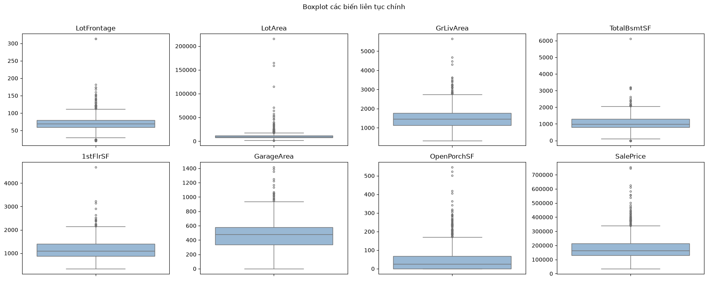
    


**Nhận xét**

- Phương pháp IQR gắn cờ rất nhiều điểm (vd. `LotArea`, `SalePrice`, `LotFrontage` có khoảng 4-7% số dòng), vì các biến này **lệch phải mạnh**: đuôi dài tự nhiên bị coi là "ngoại lệ". Đây là lý do **không nên xoá mọi điểm bị IQR gắn cờ**.
- Các biến có vài điểm cực lớn tách xa hẳn phần còn lại: `LotArea` (tới 215,245), `TotalBsmtSF` (6,110), `GrLivArea` (5,642), `LotFrontage` (313), `BsmtFinSF1` (5,644). Cần xem các điểm này có phải **cùng một vài căn nhà** hay không.

### 4.2.2. Quan hệ hai biến: ngoại lệ nằm ở đâu so với xu hướng?

Một điểm lớn chưa chắc là xấu: nếu nó **đi theo xu hướng** (nhà lớn thì giá cao) thì là ngoại lệ thật; nếu **đi ngược xu hướng** (nhà rất lớn nhưng giá thấp) thì đáng ngờ. Theo paper của De Cock, nhà có `GrLivArea > 4000` cần được xem xét.


```python
big = df[df['GrLivArea'] > 4000]
display(big[['Id', 'GrLivArea', 'TotalBsmtSF', 'LotArea', 'OverallQual',
             'Neighborhood', 'SaleType', 'SaleCondition', 'YearBuilt', 'SalePrice']])

fig, axes = plt.subplots(1, 3, figsize=(19, 5))
for ax, col in zip(axes, ['GrLivArea', 'TotalBsmtSF', 'LotArea']):
    sns.scatterplot(data=df, x=col, y='SalePrice', hue='SaleCondition', alpha=.6, s=22, ax=ax,
                    legend=(col == 'GrLivArea'))
    offsets = {524: (-12, 10), 1299: (-14, -17), 692: (-48, 4), 1183: (6, -14)}
    for _, r in df[df['Id'].isin(offsets)].iterrows():
        ax.annotate(f"Id {int(r['Id'])}", (r[col], r['SalePrice']), fontsize=9,
                    xytext=offsets[int(r['Id'])], textcoords='offset points', weight='bold')
    ax.set_ylim(0, 820000)
    ax.set_title(f'SalePrice theo {col}')
plt.tight_layout(); plt.show()
```


<div>
<style scoped>
    .dataframe tbody tr th:only-of-type {
        vertical-align: middle;
    }

    .dataframe tbody tr th {
        vertical-align: top;
    }

    .dataframe thead th {
        text-align: right;
    }
</style>
<table border="1" class="dataframe">
  <thead>
    <tr style="text-align: right;">
      <th></th>
      <th>Id</th>
      <th>GrLivArea</th>
      <th>TotalBsmtSF</th>
      <th>LotArea</th>
      <th>OverallQual</th>
      <th>Neighborhood</th>
      <th>SaleType</th>
      <th>SaleCondition</th>
      <th>YearBuilt</th>
      <th>SalePrice</th>
    </tr>
  </thead>
  <tbody>
    <tr>
      <th>523</th>
      <td>524</td>
      <td>4676</td>
      <td>3138</td>
      <td>40094</td>
      <td>10</td>
      <td>Edwards</td>
      <td>New</td>
      <td>Partial</td>
      <td>2007</td>
      <td>184750</td>
    </tr>
    <tr>
      <th>691</th>
      <td>692</td>
      <td>4316</td>
      <td>2444</td>
      <td>21535</td>
      <td>10</td>
      <td>NoRidge</td>
      <td>WD</td>
      <td>Normal</td>
      <td>1994</td>
      <td>755000</td>
    </tr>
    <tr>
      <th>1182</th>
      <td>1183</td>
      <td>4476</td>
      <td>2396</td>
      <td>15623</td>
      <td>10</td>
      <td>NoRidge</td>
      <td>WD</td>
      <td>Abnorml</td>
      <td>1996</td>
      <td>745000</td>
    </tr>
    <tr>
      <th>1298</th>
      <td>1299</td>
      <td>5642</td>
      <td>6110</td>
      <td>63887</td>
      <td>10</td>
      <td>Edwards</td>
      <td>New</td>
      <td>Partial</td>
      <td>2008</td>
      <td>160000</td>
    </tr>
  </tbody>
</table>
</div>


    
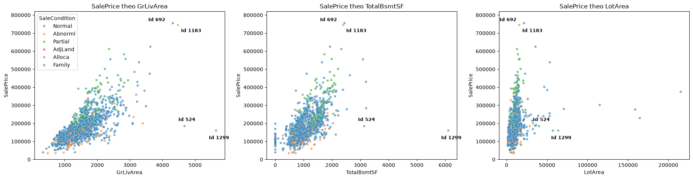
    


## Nhận xét: 4 căn có `GrLivArea > 4000` không giống nhau

- Hai căn **`1299`** và **`524`** đi **ngược xu hướng**: diện tích rất lớn, `OverallQual = 10` nhưng giá chỉ khoảng 160–185 nghìn. Cả hai đều có `SaleCondition = Partial`, nên giá bán có thể không phản ánh đầy đủ giá trị thực của diện tích. Đây là **giao dịch bất thường**.
- Hai căn **`692`** và **`1183`** có diện tích lớn và giá rất cao, **phù hợp với xu hướng chung**. Đây là các ngoại lệ có thể giữ lại vì vẫn mang thông tin hữu ích cho mô hình.

> Không nên áp dụng máy móc quy tắc **"loại bỏ tất cả `GrLivArea > 4000`"**, vì có thể loại nhầm các điểm dữ liệu hợp lệ.

## 4.2.3. Phát hiện ngoại lệ đa biến: Khoảng cách Cook

Khoảng cách Cook đo mức độ **một điểm dữ liệu có khả năng kéo lệch đường hồi quy**.

Mô hình cơ sở sử dụng:

- `log(SalePrice)`
- `log(GrLivArea)`
- `OverallQual`
- `log(LotArea)`
- `log(1 + TotalBsmtSF)`

Cài đặt khoảng cách Cook bằng **`numpy` thuần**.


```python
def ols_diagnostics(data):
    X = np.column_stack([np.ones(len(data)), np.log(data['GrLivArea']), data['OverallQual'],
                         np.log(data['LotArea']), np.log1p(data['TotalBsmtSF'])])
    y = np.log(data['SalePrice'].values)
    beta, *_ = np.linalg.lstsq(X, y, rcond=None)
    res = y - X @ beta
    n, p = X.shape
    h = np.einsum('ij,jk,ik->i', X, np.linalg.inv(X.T @ X), X)        # đòn bẩy (leverage)
    s2 = res @ res / (n - p)
    stud = res / np.sqrt(s2 * (1 - h))                                  # phần dư chuẩn hóa
    cook = (res ** 2 / (p * s2)) * (h / (1 - h) ** 2)                   # khoảng cách Cook
    r2 = 1 - (res @ res) / ((y - y.mean()) @ (y - y.mean()))
    return r2, stud, cook

r2_all, stud, cook = ols_diagnostics(df)
diag = df.assign(stud_resid=stud, cook=cook)
print(f"R² của mô hình cơ sở (giữ toàn bộ): {r2_all:.3f}")
top = diag.nlargest(8, 'cook')[['Id', 'GrLivArea', 'OverallQual', 'SalePrice', 'SaleCondition', 'stud_resid', 'cook']].round(3)
display(top)

plt.figure(figsize=(11, 4))
plt.vlines(diag.index, 0, diag['cook'], color='#4C72B0', lw=1)
for _, r in diag.nlargest(4, 'cook').iterrows():
    plt.annotate(f"Id {int(r['Id'])}", (r.name, r['cook']), xytext=(5, 0), textcoords='offset points')
plt.xlabel('Chỉ số dòng'); plt.ylabel("Khoảng cách Cook"); plt.title("Khoảng cách Cook của từng quan sát")
plt.tight_layout(); plt.show()
```

    R² của mô hình cơ sở (giữ toàn bộ): 0.787
    


<div>
<style scoped>
    .dataframe tbody tr th:only-of-type {
        vertical-align: middle;
    }

    .dataframe tbody tr th {
        vertical-align: top;
    }

    .dataframe thead th {
        text-align: right;
    }
</style>
<table border="1" class="dataframe">
  <thead>
    <tr style="text-align: right;">
      <th></th>
      <th>Id</th>
      <th>GrLivArea</th>
      <th>OverallQual</th>
      <th>SalePrice</th>
      <th>SaleCondition</th>
      <th>stud_resid</th>
      <th>cook</th>
    </tr>
  </thead>
  <tbody>
    <tr>
      <th>1298</th>
      <td>1299</td>
      <td>5642</td>
      <td>10</td>
      <td>160000</td>
      <td>Partial</td>
      <td>-8.146</td>
      <td>0.224</td>
    </tr>
    <tr>
      <th>523</th>
      <td>524</td>
      <td>4676</td>
      <td>10</td>
      <td>184750</td>
      <td>Partial</td>
      <td>-6.529</td>
      <td>0.101</td>
    </tr>
    <tr>
      <th>1045</th>
      <td>1046</td>
      <td>1733</td>
      <td>3</td>
      <td>139600</td>
      <td>Normal</td>
      <td>2.389</td>
      <td>0.034</td>
    </tr>
    <tr>
      <th>705</th>
      <td>706</td>
      <td>1092</td>
      <td>4</td>
      <td>55000</td>
      <td>Normal</td>
      <td>-2.097</td>
      <td>0.022</td>
    </tr>
    <tr>
      <th>495</th>
      <td>496</td>
      <td>720</td>
      <td>4</td>
      <td>34900</td>
      <td>Abnorml</td>
      <td>-5.159</td>
      <td>0.021</td>
    </tr>
    <tr>
      <th>30</th>
      <td>31</td>
      <td>1317</td>
      <td>4</td>
      <td>40000</td>
      <td>Normal</td>
      <td>-5.592</td>
      <td>0.018</td>
    </tr>
    <tr>
      <th>457</th>
      <td>458</td>
      <td>1663</td>
      <td>4</td>
      <td>256000</td>
      <td>Normal</td>
      <td>2.581</td>
      <td>0.017</td>
    </tr>
    <tr>
      <th>968</th>
      <td>969</td>
      <td>968</td>
      <td>3</td>
      <td>37900</td>
      <td>Abnorml</td>
      <td>-4.129</td>
      <td>0.016</td>
    </tr>
  </tbody>
</table>
</div>


    
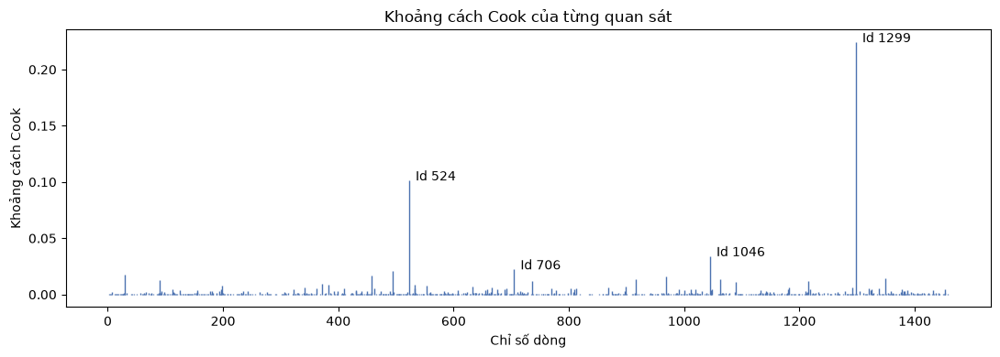
    


**Nhận xét:** hai điểm **Id 1299** (Cook ≈ 0.22) và **Id 524** (Cook ≈ 0.10) vượt xa tất cả các điểm còn lại (điểm lớn thứ ba chỉ khoảng 0.03) và có phần dư chuẩn hóa rất âm (khoảng -8.1 và -6.5): mô hình dự đoán giá cao hơn nhiều so với giá thực. Phương pháp đa biến **xác nhận độc lập** kết luận ở 4.2.2. Hai biệt thự 692 và 1183 **không** nằm trong nhóm này vì chúng đi đúng xu hướng.

Một số nhà giá rất thấp so với chất lượng (vd. Id 31, 496) cũng có phần dư lớn nhưng ảnh hưởng (Cook) nhỏ; đó là các nhà chất lượng thấp bán giá rất thấp, không có đòn bẩy lớn để kéo lệch mô hình, nên **giữ lại**.

### 4.2.4. Kiểm tra lỗi logic dữ liệu


```python
logic = {
    'YearRemodAdd < YearBuilt (sửa trước khi xây)': int((df['YearRemodAdd'] < df['YearBuilt']).sum()),
    'YrSold < YearBuilt (bán trước khi xây)'       : int((df['YrSold'] < df['YearBuilt']).sum()),
    'GarageYrBlt > YrSold (gara xây sau khi bán)'  : int((df['GarageYrBlt'] > df['YrSold']).sum()),
    'GrLivArea != 1stFlr + 2ndFlr + LowQualFin'    : int((df['GrLivArea'] != df['1stFlrSF'] + df['2ndFlrSF'] + df['LowQualFinSF']).sum()),
    'TotalBsmtSF != BsmtFin1 + BsmtFin2 + BsmtUnf' : int((df['TotalBsmtSF'] != df['BsmtFinSF1'] + df['BsmtFinSF2'] + df['BsmtUnfSF']).sum()),
    'MasVnrType = None nhưng MasVnrArea > 0'        : int(((raw['MasVnrType'] == 'None') & (df['MasVnrArea'] > 0)).sum()),
    'GarageYrBlt < YearBuilt (gara có trước nhà)'  : int((df['GarageYrBlt'] < df['YearBuilt']).sum()),
}
print("TRAIN")
display(pd.Series(logic, name='số dòng vi phạm').to_frame())
print("TEST: GarageYrBlt > YrSold")
display(test.loc[test['GarageYrBlt'] > test['YrSold'], ['Id', 'YearBuilt', 'GarageYrBlt', 'YrSold']])
print("Giao dịch trong dữ liệu kéo dài từ", test['YrSold'].min(), "đến", test['YrSold'].max(),
      "-> mọi năm xây dựng phải <=", test['YrSold'].max())
```

    TRAIN
    


<div>
<style scoped>
    .dataframe tbody tr th:only-of-type {
        vertical-align: middle;
    }

    .dataframe tbody tr th {
        vertical-align: top;
    }

    .dataframe thead th {
        text-align: right;
    }
</style>
<table border="1" class="dataframe">
  <thead>
    <tr style="text-align: right;">
      <th></th>
      <th>số dòng vi phạm</th>
    </tr>
  </thead>
  <tbody>
    <tr>
      <th>YearRemodAdd &lt; YearBuilt (sửa trước khi xây)</th>
      <td>0</td>
    </tr>
    <tr>
      <th>YrSold &lt; YearBuilt (bán trước khi xây)</th>
      <td>0</td>
    </tr>
    <tr>
      <th>GarageYrBlt &gt; YrSold (gara xây sau khi bán)</th>
      <td>0</td>
    </tr>
    <tr>
      <th>GrLivArea != 1stFlr + 2ndFlr + LowQualFin</th>
      <td>0</td>
    </tr>
    <tr>
      <th>TotalBsmtSF != BsmtFin1 + BsmtFin2 + BsmtUnf</th>
      <td>0</td>
    </tr>
    <tr>
      <th>MasVnrType = None nhưng MasVnrArea &gt; 0</th>
      <td>5</td>
    </tr>
    <tr>
      <th>GarageYrBlt &lt; YearBuilt (gara có trước nhà)</th>
      <td>9</td>
    </tr>
  </tbody>
</table>
</div>


    TEST: GarageYrBlt > YrSold
    


<div>
<style scoped>
    .dataframe tbody tr th:only-of-type {
        vertical-align: middle;
    }

    .dataframe tbody tr th {
        vertical-align: top;
    }

    .dataframe thead th {
        text-align: right;
    }
</style>
<table border="1" class="dataframe">
  <thead>
    <tr style="text-align: right;">
      <th></th>
      <th>Id</th>
      <th>YearBuilt</th>
      <th>GarageYrBlt</th>
      <th>YrSold</th>
    </tr>
  </thead>
  <tbody>
    <tr>
      <th>1089</th>
      <td>2550</td>
      <td>2008</td>
      <td>2008.0</td>
      <td>2007</td>
    </tr>
    <tr>
      <th>1132</th>
      <td>2593</td>
      <td>2006</td>
      <td>2207.0</td>
      <td>2007</td>
    </tr>
  </tbody>
</table>
</div>


    Giao dịch trong dữ liệu kéo dài từ 2006 đến 2010 -> mọi năm xây dựng phải <= 2010
    

## Nhận xét

- Các ràng buộc cộng diện tích (`GrLivArea`, `TotalBsmtSF`) và thứ tự thời gian đều **khớp 100%** trên `train`: dữ liệu rất sạch về logic.
- 9 dòng có `GarageYrBlt < YearBuilt` là hợp lý (gara có từ trước khi nhà được xây lại), **không phải lỗi**.
- 5 dòng `MasVnrType = None` nhưng `MasVnrArea > 0` (có 2 dòng chỉ bằng 1 sq ft) là sai lệch nhỏ, ảnh hưởng không đáng kể nên chỉ ghi nhận.
- Trên `test` có 2 dòng `GarageYrBlt > YrSold`, nhưng chỉ **một dòng là lỗi**:
  - **Id 2593**: `GarageYrBlt = 2207` (nhà xây 2006, bán 2007) là năm không thể có, nhiều khả năng gõ nhầm của 2007. Phải sửa vì một năm trong tương lai sẽ làm méo mọi đặc trưng tuổi gara.
  - **Id 2550**: nhà xây 2008 nhưng bán 2007, gara cùng năm với nhà. Đây là trường hợp bán khi nhà chưa hoàn thiện (xem `SaleCondition = Partial`), **hợp lý, giữ nguyên**.

## 4.2.5. Hướng giải quyết cho ngoại lệ

- **Id 524, 1299** (rất lớn, `Partial`, giá thấp bất thường)
  - **Quyết định:** **Xoá khỏi `train`**.
  - **Lý do:** Là giao dịch bất thường, đi ngược xu hướng, ảnh hưởng (Cook) cao gấp 3–7 lần các điểm khác; kéo giảm tương quan `GrLivArea`–`SalePrice`.

- **Id 692, 1183** (nhà lớn, giá cao, đúng xu hướng)
  - **Quyết định:** **Giữ**.
  - **Lý do:** Ngoại lệ thật; mô hình cần học được vùng giá cao.

- **Các điểm bị IQR gắn cờ do đuôi lệch phải (`LotArea`, `SalePrice`, `OpenPorchSF`...)
  - **Quyết định:** **Giữ**, xử lý bằng **biến đổi log** (`log1p`).
  - **Lý do:** Là đặc tính của phân phối, không phải lỗi. Log làm giảm tác động của đuôi.

- **Lỗi nhập liệu `GarageYrBlt = 2207` ở `test` (Id 2593)**
  - **Quyết định:** **Sửa** (thay bằng `YearBuilt`; hoặc 2007 nếu cho đó là gõ nhầm).
  - **Lý do:** Lỗi rõ ràng, không thể xoá dòng của `test`.

- **Mô hình nhạy với ngoại lệ (hồi quy tuyến tính, Ridge/Lasso, KNN)**
  - **Quyết định:** Thêm **cắt ngưỡng (winsorize) 1%–99%** học từ `train`, hoặc dùng `RobustScaler`, `HuberRegressor`.
  - **Lý do:** Hạn chế ảnh hưởng của vài điểm cực lớn mà không mất dòng nào.

- **Mô hình cây (Random Forest, Gradient Boosting)**
  - **Quyết định:** Gần như không cần xử lý thêm.
  - **Lý do:** Cây chia theo ngưỡng, ít nhạy với giá trị cực lớn.

> **Lưu ý:** `test` có nhà `GrLivArea = 5095` (lớn hơn mọi nhà trong `train` ngoại trừ Id 1299). Không được xoá dòng của `test`, nên mô hình phải đủ bền vững với giá trị lớn (vì thế nên dùng log hoặc cắt ngưỡng bằng giá trị học từ `train`).


```python
# (a) Xoá 2 giao dịch bất thường khỏi train
OUTLIER_IDS = [524, 1299]
train_clean = train_clean[~train_clean['Id'].isin(OUTLIER_IDS)].reset_index(drop=True)

# (b) Sửa lỗi nhập liệu ở test: năm xây gara vượt quá thời gian của dữ liệu (2006-2010)
bad = test_clean['GarageYrBlt'] > test_clean['YrSold'].max()
print("Dòng test sửa:", test_clean.loc[bad, ['Id', 'YearBuilt', 'GarageYrBlt', 'YrSold']].to_dict('records'))
test_clean.loc[bad, 'GarageYrBlt'] = test_clean.loc[bad, 'YearBuilt']

print("train_clean:", train_clean.shape, "| test_clean:", test_clean.shape)
```

    Dòng test sửa: [{'Id': 2593, 'YearBuilt': 2006, 'GarageYrBlt': 2207.0, 'YrSold': 2007}]
    train_clean: (1458, 81) | test_clean: (1459, 80)
    

#### Kiểm chứng quyết định: chỉ xoá 2 điểm là đủ?

So sánh ba phương án trên cùng mô hình cơ sở: giữ hết, xoá 2 điểm (524, 1299), xoá cả 4 điểm `GrLivArea > 4000` (theo quy tắc của paper).


```python
scen = {
    'Giữ nguyên (1460 dòng)'                        : df,
    'Xoá Id 524, 1299 (1458 dòng)  <- chọn'         : df[~df['Id'].isin([524, 1299])],
    'Xoá cả 4 điểm GrLivArea > 4000 (1456 dòng)'    : df[df['GrLivArea'] <= 4000],
}
rows = []
for name, d in scen.items():
    r2, _, ck = ols_diagnostics(d)
    rows.append({'phương án': name,
                 'corr(GrLivArea, SalePrice)': round(d['GrLivArea'].corr(d['SalePrice']), 3),
                 'R² mô hình cơ sở': round(r2, 3),
                 'Cook lớn nhất': round(ck.max(), 3)})
pd.DataFrame(rows).set_index('phương án')
```


<div>
<style scoped>
    .dataframe tbody tr th:only-of-type {
        vertical-align: middle;
    }

    .dataframe tbody tr th {
        vertical-align: top;
    }

    .dataframe thead th {
        text-align: right;
    }
</style>
<table border="1" class="dataframe">
  <thead>
    <tr style="text-align: right;">
      <th></th>
      <th>corr(GrLivArea, SalePrice)</th>
      <th>R² mô hình cơ sở</th>
      <th>Cook lớn nhất</th>
    </tr>
    <tr>
      <th>phương án</th>
      <th></th>
      <th></th>
      <th></th>
    </tr>
  </thead>
  <tbody>
    <tr>
      <th>Giữ nguyên (1460 dòng)</th>
      <td>0.709</td>
      <td>0.787</td>
      <td>0.224</td>
    </tr>
    <tr>
      <th>Xoá Id 524, 1299 (1458 dòng)&nbsp;&nbsp;&lt;- chọn</th>
      <td>0.735</td>
      <td>0.803</td>
      <td>0.037</td>
    </tr>
    <tr>
      <th>Xoá cả 4 điểm GrLivArea &gt; 4000 (1456 dòng)</th>
      <td>0.721</td>
      <td>0.800</td>
      <td>0.037</td>
    </tr>
  </tbody>
</table>
</div>


**Nhận xét:** xoá đúng 2 điểm bất thường làm tương quan `GrLivArea`-`SalePrice` tăng rõ (0.709 → 0.735) và R² tăng, Cook lớn nhất giảm mạnh. Xoá cả 4 điểm cho kết quả **kém hơn một chút** (tương quan 0.721; R² 0.800 so với 0.803) vì loại nhầm 2 biệt thự đúng xu hướng. Chênh lệch R² nhỏ, nhưng quan trọng hơn là xoá 2 điểm hợp lệ làm mất thông tin về nhóm nhà giá cao nhất.

Ngoài ra, chỉ 2 dòng này đã chi phối độ lệch: sau khi xoá, `skew` của `GrLivArea` giảm từ 1.37 xuống 1.01 và của `TotalBsmtSF` từ 1.52 xuống 0.51 (xem bảng ở 4.2.6). Vậy quy tắc "bỏ `GrLivArea > 4000`" của paper được áp dụng cho bộ dữ liệu đầy đủ 2930 dòng, còn trên `train.csv` này cần kiểm tra từng điểm như trên.

### 4.2.6. Biến đổi log và cắt ngưỡng cho phần đuôi lệch

Với các điểm "ngoại lệ thật" được giữ lại, có hai công cụ giảm ảnh hưởng của đuôi dài mà không mất dòng nào. Ngưỡng cắt phải **học từ `train`**.


```python
def fit_clip(train, cols, lo=0.01, hi=0.99):
    return {c: (train[c].quantile(lo), train[c].quantile(hi)) for c in cols}

def apply_clip(data, bounds):
    d = data.copy()
    for c, (a, b) in bounds.items():
        d[c] = d[c].clip(a, b)
    return d

clip_cols = ['LotArea', 'GrLivArea', 'TotalBsmtSF', 'SalePrice']
bounds = fit_clip(train_clean, clip_cols)

skew_tab = pd.DataFrame({
    'skew gốc'            : train_clean[clip_cols].skew(),
    'skew sau cắt 1%-99%' : apply_clip(train_clean, bounds)[clip_cols].skew(),
    'skew sau log1p'      : np.log1p(train_clean[clip_cols]).skew(),
}).round(2)
display(skew_tab)
```


<div>
<style scoped>
    .dataframe tbody tr th:only-of-type {
        vertical-align: middle;
    }

    .dataframe tbody tr th {
        vertical-align: top;
    }

    .dataframe thead th {
        text-align: right;
    }
</style>
<table border="1" class="dataframe">
  <thead>
    <tr style="text-align: right;">
      <th></th>
      <th>skew gốc</th>
      <th>skew sau cắt 1%-99%</th>
      <th>skew sau log1p</th>
    </tr>
  </thead>
  <tbody>
    <tr>
      <th>LotArea</th>
      <td>12.57</td>
      <td>2.20</td>
      <td>-0.18</td>
    </tr>
    <tr>
      <th>GrLivArea</th>
      <td>1.01</td>
      <td>0.77</td>
      <td>-0.07</td>
    </tr>
    <tr>
      <th>TotalBsmtSF</th>
      <td>0.51</td>
      <td>0.22</td>
      <td>-5.17</td>
    </tr>
    <tr>
      <th>SalePrice</th>
      <td>1.88</td>
      <td>1.27</td>
      <td>0.12</td>
    </tr>
  </tbody>
</table>
</div>


**Nhận xét**

- `log1p` đưa `SalePrice`, `LotArea`, `GrLivArea` về gần đối xứng (skew xấp xỉ 0): đây là cách xử lý đuôi hiệu quả nhất cho các biến này. Với biến mục tiêu `SalePrice`, nên huấn luyện trên `log1p(SalePrice)` rồi đổi ngược bằng `np.expm1` khi dự đoán.
- **Cẩn thận với `TotalBsmtSF`**: biến này có nhiều giá trị 0 (nhà không có hầm), `log1p` biến chúng thành 0 trong khi các giá trị còn lại khoảng 6-8, tạo skew rất âm (khoảng -5). Với biến nhiều số 0 nên dùng cờ `HasBsmt` + log của phần > 0, hoặc chỉ cắt ngưỡng, không log thẳng.
- Cắt ngưỡng 1%-99% giảm skew ít hơn log nhưng giữ nguyên thang đo gốc, hữu ích khi cần giải thích hệ số.

## 4.3. Tổng kết Phần 4

**Giá trị thiếu**
- 19 cột có `NaN`, nhưng phần lớn là **"không có đặc trưng"** (hồ bơi, hẻm, hàng rào, lò sưởi, gara, tầng hầm), đã kiểm chứng với các cột số đi kèm. Chỉ khoảng 280 ô là thiếu thật, chủ yếu `LotFrontage`.
- Cẩn thận `pd.read_csv` đọc nhãn hợp lệ `NA`/`None` thành `NaN` (ví dụ `MasVnrType`: 864 trong 872 dòng là `None` hợp lệ).
- Xử lý: điền `'None'` cho thiếu có cấu trúc, `0` cho diện tích tương ứng, `YearBuilt` cho `GarageYrBlt`, median theo `Neighborhood` cho `LotFrontage` (thí nghiệm cho sai số thấp hơn median toàn cục), mode cho `Electrical`. **Không xoá dòng, không xoá cột** chỉ vì thiếu.

**Ngoại lệ**
- IQR gắn cờ nhiều điểm do phân phối lệch phải; chỉ coi là **ứng viên**.
- Kết hợp quan hệ hai biến, khoảng cách Cook và `SaleCondition` xác định đúng **2 giao dịch bất thường (Id 524, 1299)** → xoá khỏi `train`. Hai biệt thự `GrLivArea > 4000` còn lại (692, 1183) đúng xu hướng → giữ.
- Đuôi lệch còn lại xử lý bằng `log1p` (hoặc cắt ngưỡng học từ `train` nếu mô hình nhạy ngoại lệ); sửa lỗi nhập liệu `GarageYrBlt = 2207` ở `test`.

**Quy trình khi mô hình hóa:** học tham số (median, mode, ngưỡng cắt) từ `train` → áp dụng cho `train` và `test` → chỉ xoá dòng ở `train`, không xoá dòng ở `test`.

Dữ liệu đã làm sạch: `train_clean`, `test_clean` (dùng cho các phần tiếp theo).
